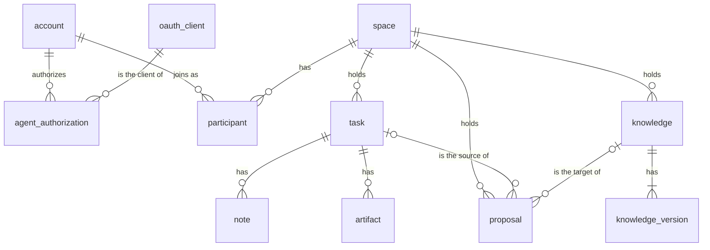

# Data Model

- **Status:** Proposed
- **Level:** Implementation
- **Parent:** [Storage](storage.md)
- **Related:** [Identity](identity.md),
  [Access control](../contracts/access-control.md),
  [Tasks](../contracts/tasks.md),
  [Knowledge](../contracts/knowledge.md),
  [Keys and references](../contracts/keys-and-references.md)

> Participant rows hold only people. An agent's spaces and role are derived
> from its person on every request, never stored.
>
> Primary keys never leave `lorebayd`. Callers see keys and random task IDs.

## 1. Purpose

This doc defines the tables behind Lorebay's data: their columns, their
constraints, the rules they keep, and the SQL that creates them.

## 2. Scope

This doc covers all 14 tables: the 10 business tables, and the 4 tables only
the authorization implementation uses, `login_session`, `oauth_code`,
`oauth_client` and `refresh_token_history`. Behavior observable through the
APIs is in the contract docs.

It does not cover:

- the table in which the migration tool records which migrations have run;
  the tool maintains it.

## 3. Conventions

- **Names.** Table names are lowercase English singular nouns; column names
  are snake_case.
- **Table names avoid SQL reserved words.** `user` and `authorization` are
  reserved in Postgres, so the tables are `account` and
  `agent_authorization`. The latter also tells an agent's credential apart
  from a person's login session.
- **Types are only INTEGER and TEXT.** Primary keys and their foreign keys
  are TEXT on both SQLite and Postgres. Times, numbers, sizes and versions
  remain INTEGER, declared with the big integer type so Postgres uses
  BIGINT.
- **Times are UTC milliseconds**, in columns ending in `_at`. A yes-or-no
  fact is a nullable time, never a flag: an empty `deleted_at` means not
  deleted.
- **The application generates every primary key `id` before the insert.**
  It is a UUIDv7 stored as canonical lowercase, hyphenated text: 36
  characters with hexadecimal groups of 8, 4, 4, 4 and 12 digits, version 7
  and the RFC variant. Every primary key is NOT NULL and has no database
  generation or default.
- **Primary keys identify internal rows and break ordering ties.** They
  never define the business order and never appear in a token or an API.
  Calls use public keys, such as `SPACE-1` and `TK-12`, and random task IDs.
  A space's key uses its separate `number`, never its primary key.
- **Random IDs remain separate from primary keys.** The task, login session
  and agent authorization keep their 128-random-bit `random_id` columns.
  A UUIDv7's timestamp and fewer random bits cannot replace those values.
- **Keys.** A table whose rows have keys has a `number` column, unique
  together with `space_id`. The table fixes the prefix: `TK` for `task`, `KN`
  for `knowledge`, `AR` for `artifact` and `PP` for `proposal`. Numbers come
  from counters on `space`; see [section 6.1](#61-space).
- **Statuses and kinds** are stored as lowercase English values, as the
  contracts write them, with a CHECK constraint, such as `in progress` or
  `ended` for a task's `status`.
- **Case-insensitive uniqueness** uses a second column, `name_key`, holding
  the name in lowercase, with the unique constraint on it. `lorebayd`
  lowercases in code, not through a database collation, so SQLite and
  Postgres agree and Chinese text is unaffected.
- **Foreign keys are declared**, and every SQLite connection turns on
  `PRAGMA foreign_keys`. Each table's section says what a delete cascades to
  or clears.
- **Refresh tokens and authorization codes are stored only as SHA-256
  hashes.** The raw value is returned once, when it is issued. Access tokens
  are signed and not stored; see [Identity](identity.md#7-tokens).
- **Keyword search uses `LIKE`**, not a full-text index; see
  [Storage](storage.md#5-database). `%` and `_` in the keyword are escaped,
  with `LIKE ? ESCAPE '\'`, or `a_b` would match `axb`. SQLite's `LIKE`
  ignores case only for ASCII letters. Listing Knowledge by prefix does not
  use `LIKE`; see [section 8.1](#81-knowledge).
- **References are not stored.** Pages resolve `#KN-1` when they show the
  text.
- **Schema changes are numbered migration files**, embedded in the
  executable. At startup `lorebayd` runs, in order, those not yet run.

## 4. How the tables relate



Tasks, knowledge entries, proposals and participants belong to a space;
notes and artifacts belong to a task; each knowledge entry's history is in
`knowledge_version`. The six account and authorization tables belong to no
space.

## 5. Accounts and authorization

### 5.1 `account`

A mirror of the users file, synced at startup.

| Column | Type | Constraints | Meaning |
| --- | --- | --- | --- |
| `id` | TEXT | Primary key, not null | |
| `username` | TEXT | Not null, unique | The username in the users file |
| `deleted_at` | INTEGER | Nullable | When the username was removed from the file; empty while it is there |
| `created_at` | INTEGER | Not null | When the first sync added it |

- **Password hashes stay out of the database**, only in the users file.
- **Startup sync.** A username in the file but not in the table gets a row.
  A row whose username left the file gets `deleted_at`, and its
  `participant`, `agent_authorization` and `login_session` rows and its
  `oauth_code` rows are deleted. A deleted row whose username is
  back in the file gets `deleted_at` cleared: it is the same person. What
  that means for the person is in [Identity](identity.md#3-accounts).
- **Rows are never deleted**, so tasks and proposals still show whose they
  were.

### 5.2 `agent_authorization`

One row per agent; see [Identity](identity.md#6-agent-authorization).

| Column | Type | Constraints | Meaning |
| --- | --- | --- | --- |
| `id` | TEXT | Primary key, not null | |
| `account_id` | TEXT | Not null, foreign key to `account` | The person who authorized |
| `client_id` | TEXT | Not null, foreign key to `oauth_client` | The registered client |
| `name` | TEXT | Not null | The agent name; defaults to the client name, and the person may change it when consenting |
| `random_id` | TEXT | Not null, unique | Names the authorization in its access tokens: 128 random bits, encoded as a string |
| `refresh_token_hash` | TEXT | Not null, unique | |
| `refresh_expires_at` | INTEGER | Not null | |
| `created_at` | INTEGER | Not null | When the person authorized |

- **`(account_id, name)` is unique**, compared exactly. Consent checks
  first, and the constraint catches the rest when the row is created.
  Replacing an agent of the same name is in [section 5.4](#54-oauth_code).
- **Each request** verifies the access token's signature and expiry, finds
  the row by the `random_id` the token names, and checks that the account is
  not deleted. The primary key `id` never appears in a token.
- **A refresh replaces the refresh token.** In one transaction it records
  the replaced hash and its current `refresh_expires_at` in
  [the refresh token history](#56-refresh_token_history), stores the new
  hash, signs an access token and moves `refresh_expires_at` forward.
- **Presenting any unexpired token in the history deletes the row.** The
  deletion commits even though the refresh is refused, whichever `client_id`
  the request names. All of the row's tokens then stop working, and the person
  authorizes the agent again. An expired history entry ends nothing. The
  caller gets the same error as for an unknown refresh token;
  [Identity](identity.md#7-tokens) defines the replay rule.
- **Revoking the authorization or deleting the account deletes the row.**
  Its access tokens then name no row and are rejected. Its refresh token
  history is deleted by cascade. Tasks keep the agent name they copied.
- **A background job removes rows whose refresh token has expired**; see
  [System architecture](system.md#6-background-jobs).

### 5.3 `login_session`

A person's login session, from the web pages or the `lorebay` CLI.

| Column | Type | Constraints | Meaning |
| --- | --- | --- | --- |
| `id` | TEXT | Primary key, not null | |
| `account_id` | TEXT | Not null, foreign key to `account` | The person signed in |
| `random_id` | TEXT | Not null, unique | Names the session in its access tokens: 128 random bits, encoded as a string |
| `refresh_token_hash` | TEXT | Not null, unique | |
| `created_at` | INTEGER | Not null | |
| `expires_at` | INTEGER | Not null | When the refresh token expires |

- **Requests and refreshes** work as for an agent authorization; see
  [section 5.2](#52-agent_authorization). Both the Web API and the token
  endpoint record and check the same refresh token history, and delete the
  row on replay. The person signs in again. A refresh also moves `expires_at`
  forward.
- **A row is deleted on logout and with its account**, cascading to its
  refresh token history. A background job removes expired rows; see
  [System architecture](system.md#6-background-jobs).

### 5.4 `oauth_code`

An authorization code, usable once and retained until its expiry after exchange.

| Column | Type | Constraints | Meaning |
| --- | --- | --- | --- |
| `id` | TEXT | Primary key, not null | |
| `code_hash` | TEXT | Not null, unique | |
| `account_id` | TEXT | Not null, foreign key to `account` | The person who signed in and consented |
| `client_id` | TEXT | Not null | The registered client, or the built-in `lorebay` CLI client |
| `redirect_uri` | TEXT | Not null | Must match when the code is exchanged |
| `code_challenge` | TEXT | Not null | The PKCE S256 challenge |
| `agent_name` | TEXT | Nullable | The agent name the person chose when consenting; empty for a code issued to the `lorebay` CLI |
| `replaces_authorization_id` | TEXT | Nullable, foreign key to `agent_authorization`, set null on delete | The authorization to replace, when the name was taken and the person chose to replace it |
| `created_at` | INTEGER | Not null | |
| `expires_at` | INTEGER | Not null | |
| `exchanged_at` | INTEGER | Nullable | Null until the code is exchanged; remains set after its issued credential ends |
| `agent_authorization_id` | TEXT | Nullable, foreign key to `agent_authorization`, set null on delete | The agent authorization this exchange produced |
| `login_session_id` | TEXT | Nullable, foreign key to `login_session`, set null on delete | The login session this exchange produced for the CLI |

- **Exchanging the code is one transaction.** It deletes the authorization
  being replaced, if any, which ends its tokens; creates the
  `agent_authorization` row; and sets `exchanged_at` and
  `agent_authorization_id` on this row, clearing `replaces_authorization_id`.
- **A code issued to the `lorebay` CLI creates a `login_session` row
  instead**, recording its ID in `login_session_id`, because the CLI signs
  a person in; see
  [Identity](identity.md#5-sign-in). The CLI client is built into `lorebayd`
  and has no `oauth_client` row, so `client_id` is not a foreign key.
- **A matching second exchange deletes only the issued credential.** The
  client, redirect URI and PKCE verifier must match, as
  [Identity](identity.md#7-tokens) specifies. The deletion commits although
  the request returns the error of an unknown code. Another second exchange
  or an expired code deletes nothing. The two issued-owner columns cannot
  both be set. Once an owner is deleted, its reference becomes null while
  `exchanged_at` prevents another exchange from issuing tokens.
- **Expired codes, exchanged or not,** are removed by a background job.

### 5.5 `oauth_client`

The clients registered through Dynamic Client Registration; see
[Identity](identity.md#6-agent-authorization).

| Column | Type | Constraints | Meaning |
| --- | --- | --- | --- |
| `id` | TEXT | Primary key, not null | |
| `client_id` | TEXT | Not null, unique | Generated at registration: 128 random bits, encoded as a string |
| `client_name` | TEXT | Not null | The client name the client registered; the default agent name at consent |
| `metadata` | TEXT | Not null | The registration as accepted, as JSON, with its redirect URIs |
| `created_at` | INTEGER | Not null | |

- **Authorization looks the client up by `client_id`** and checks the
  `redirect_uri` against the registered ones.
- **Rows are never deleted or changed.** An `agent_authorization` row names
  its client, and a client registers again to change its metadata.

### 5.6 `refresh_token_history`

Each refresh token replaced by a refresh of an agent authorization or login session.

| Column | Type | Constraints | Meaning |
| --- | --- | --- | --- |
| `id` | TEXT | Primary key, not null | |
| `token_hash` | TEXT | Not null, unique | SHA-256 hash of the replaced refresh token |
| `agent_authorization_id` | TEXT | Nullable, foreign key to `agent_authorization`, cascade on delete | The authorization this token belonged to |
| `login_session_id` | TEXT | Nullable, foreign key to `login_session`, cascade on delete | The session this token belonged to |
| `expires_at` | INTEGER | Not null | When the replaced token would have expired |

- **Exactly one owner is set**, enforced by a CHECK constraint. Each owner
  column and `expires_at` have an index. Token lookup uses the unique hash.
- **A refresh records the replaced token's existing expiry**, before moving
  the owner's expiry forward. Later refreshes never extend this entry.
  Both login session refresh endpoints use this table.
- **An unexpired entry identifies a replay**, as
  [section 5.2](#52-agent_authorization) defines. An expired entry never ends
  its owner, even before the background job removes it.
- **The history ends with its owner.** Revocation, logout, account removal,
  replacement, replay and expired-owner cleanup cascade to the history.
  The background job also deletes entries whose `expires_at` has passed,
  bounding history by the refresh token lifetime.
- **Upgrade preserves the previously remembered hash.** Earlier schemas
  did not record its original expiry, so migration uses the owner's stored
  expiry for that one entry. Subsequent entries retain the exact token expiry.

## 6. Spaces and participants

### 6.1 `space`

| Column | Type | Constraints | Meaning |
| --- | --- | --- | --- |
| `id` | TEXT | Primary key, not null | Internal UUIDv7 |
| `number` | INTEGER | Not null, unique | The number in `SPACE-1`; never reused |
| `name` | TEXT | Not null | Need not be unique |
| `summary` | TEXT | Not null | |
| `next_task_number` | INTEGER | Not null, default 1 | The next `TK` number |
| `next_knowledge_number` | INTEGER | Not null, default 1 | The next `KN` number |
| `next_artifact_number` | INTEGER | Not null, default 1 | The next `AR` number |
| `next_proposal_number` | INTEGER | Not null, default 1 | The next `PP` number |
| `created_at` | INTEGER | Not null | |
| `updated_at` | INTEGER | Not null | When the name or summary last changed |

- **The owner is stored only as a role.** `space` has no owner column; the
  participant row whose role is `owner` is the one record, so the two can
  never disagree. Every request already reads the caller's participant row,
  and showing the owner is one lookup in the `participant_one_owner` index.
- **Taking a key.** Creating a task, knowledge entry, artifact or proposal
  increments the matching counter in the same transaction and uses the value
  before the increment. Taking the current maximum plus one would reuse the
  keys of deleted records.
- **Space numbers are permanent and count up across the Lorebay.** Creating
  a space takes the highest `space.number` plus one, or 1 when no space
  exists, inside the same write transaction that creates it and its owner
  participant. Spaces are never deleted, so a committed number is never
  reused. The unique constraint guards concurrent allocations; a number
  conflict rolls back and retries the entire write transaction. On SQLite
  the transaction begins in immediate mode; Postgres must also retry a
  serialization failure. The primary key is generated independently of the
  number.
- **Spaces are never deleted**, as [Lorebay](../product/lorebay.md#2-scope)
  states, so this table has no delete.

### 6.2 `participant`

| Column | Type | Constraints | Meaning |
| --- | --- | --- | --- |
| `id` | TEXT | Primary key, not null | |
| `space_id` | TEXT | Not null, foreign key to `space` | |
| `account_id` | TEXT | Not null, foreign key to `account` | |
| `role` | TEXT | Not null | `owner`, `admin`, `contributor` or `viewer` |
| `created_at` | INTEGER | Not null | When the person joined |
| `updated_at` | INTEGER | Not null | When the role last changed |

- **`(space_id, account_id)` is unique.** A partial unique index on the rows
  whose role is `owner` allows at most one owner per space. Creating a space
  adds the owner's row in the same transaction.
- **Only people are stored.** An agent's spaces and role are computed from
  its person on every request: the agents of owners and admins are
  contributors, and other agents have their person's role; see
  [Access control](../contracts/access-control.md#3-participants-and-roles).
  "An agent follows its person" thus needs no sync.
- **Removing a participant deletes the row**, and so does deleting the
  account; see [section 5.1](#51-account).
- **Index:** `account_id`, to list a person's spaces.

## 7. Tasks, notes and artifacts

### 7.1 `task`

| Column | Type | Constraints | Meaning |
| --- | --- | --- | --- |
| `id` | TEXT | Primary key, not null | |
| `space_id` | TEXT | Not null, foreign key to `space` | |
| `number` | INTEGER | Not null | The `TK` number; `(space_id, number)` is unique |
| `random_id` | TEXT | Not null, unique | The task ID: 128 random bits, encoded as a string |
| `account_id` | TEXT | Not null, foreign key to `account` | Whose task it is |
| `agent_name` | TEXT | Not null | Copied from the authorization at creation |
| `title` | TEXT | Not null | |
| `status` | TEXT | Not null | `in progress` or `ended` |
| `result` | TEXT | Not null, default empty | Markdown, replaced whole on each update |
| `started_at` | INTEGER | Not null | |
| `ended_at` | INTEGER | Nullable | Set when the task becomes `ended`, cleared when it returns to `in progress` |
| `last_activity_at` | INTEGER | Not null | Equal to `started_at` at creation; set to the current time on each note, artifact or result update |

- **A task names its agent by the copied name**, not by a reference to the
  authorization. Filtering by agent matches `(account_id, agent_name)`.
  Agent names are unique per person, so the filter still works after the
  authorization is revoked, and an agent authorized again under the same
  name is filtered together with its earlier tasks.
- **A CHECK ties `ended_at` to `status`**: set when `ended`, empty when
  `in progress`.
- **`(id, space_id)` is unique** so that `artifact` can reference a task
  together with its space; see [section 7.3](#73-artifact).
- **Deletion is real.** Deleting a task, by its owner or by a space owner or
  admin, cascades to its notes and artifact rows, and clears the source task
  of its proposals; keys written in text stay and show as plain text. The
  artifact files are deleted after the transaction commits; see
  [Storage](storage.md#5-database).
- **Indexes:** `(space_id, last_activity_at)` to list tasks;
  `(space_id, account_id, status)` to list a party's tasks that are not
  `ended`.
- **Keyword search** covers `title` and `result`.

### 7.2 `note`

| Column | Type | Constraints | Meaning |
| --- | --- | --- | --- |
| `id` | TEXT | Primary key, not null | |
| `task_id` | TEXT | Not null, foreign key to `task`, cascades on delete | |
| `content` | TEXT | Not null | Markdown |
| `created_at` | INTEGER | Not null | The note's time |

- **No agent is recorded**, because notes belong to the task; see
  [Tasks](../contracts/tasks.md#3-tasks). Notes are only appended and
  deleted, so there is no `updated_at`.
- **Index:** `(task_id, created_at)`, for time order and paging.

### 7.3 `artifact`

| Column | Type | Constraints | Meaning |
| --- | --- | --- | --- |
| `id` | TEXT | Primary key, not null | |
| `space_id` | TEXT | Not null, foreign key to `space` | The same as its task's space |
| `task_id` | TEXT | Not null; `(task_id, space_id)` is a foreign key to `task`, cascades on delete | |
| `number` | INTEGER | Not null | The `AR` number; `(space_id, number)` is unique |
| `file_name` | TEXT | Not null | |
| `summary` | TEXT | Not null | |
| `storage_key` | TEXT | Not null, unique | The file's location in storage: a path relative to the local directory, or an S3 key |
| `size` | INTEGER | Nullable | Bytes, read from storage when the upload is reported complete |
| `created_at` | INTEGER | Not null | When the artifact was registered |
| `completed_at` | INTEGER | Nullable | When the upload was reported complete; until then the artifact is not listed among the task's artifacts |

- **The key is taken at registration**, and `complete_artifact` names the
  artifact by it. A background job removes registrations that were never
  completed; their keys stay unused.
- **Lorebay generates `storage_key`**, never from the file name, so files
  with the same name never overwrite each other; see
  [Storage](storage.md#4-file-storage).
- **Whether a browser may open the file** follows the extension of
  `file_name`, as [Storage](storage.md#4-file-storage) describes. No type is
  stored.
- **`space_id` is here** for key uniqueness and space checks. The composite
  foreign key `(task_id, space_id)` keeps it equal to the task's space. A
  CHECK allows `size` only once the upload is complete.
- **Index:** `task_id`.

## 8. Knowledge and proposals

### 8.1 `knowledge`

One row per knowledge entry; its content is in `knowledge_version`.

| Column | Type | Constraints | Meaning |
| --- | --- | --- | --- |
| `id` | TEXT | Primary key, not null | |
| `space_id` | TEXT | Not null, foreign key to `space` | |
| `number` | INTEGER | Not null | The `KN` number; `(space_id, number)` is unique |
| `name` | TEXT | Not null | As written, and shown that way |
| `name_key` | TEXT | Not null | `name` in lowercase; `(space_id, name_key)` is unique |
| `latest_version` | INTEGER | Not null | The number of the latest version, the only one agents read |
| `deleted_at` | INTEGER | Nullable | When the entry was deleted; empty if it is not |
| `created_at` | INTEGER | Not null | |
| `updated_at` | INTEGER | Not null | When a version was last added or the entry last renamed |

- **The name lives on this row.** A rename changes only `name` and
  `name_key`: it adds no version and keeps the key, and rolling back never
  restores an old name. The rules for names are in
  [Knowledge](../contracts/knowledge.md#3-knowledge-entries).
- **Names are unique ignoring case**, deleted entries included, through
  `name_key`. Reading by name looks up `name_key` too. A rename that changes
  only the case passes the constraint, because it is the same row; a check
  in code before it must skip the entry itself.
- **Listing by prefix** lowercases the prefix and runs a range query, such as
  `name_key >= 'docs/' AND name_key < 'docs0'` for `docs/`, since `0` is the
  character after `/`. The query uses the `(space_id, name_key)` index and
  needs no escaping. Code splits the rows into this level's entries and the
  next level's prefixes; a level whose entries spell it differently shows as
  the entry with the lowest number spells it. Deleted entries are left out.
  The range compares bytes, so on Postgres `name_key` would need
  `COLLATE "C"`.
- **Search** covers the name and the latest version's summary and content.
- **Deleting marks the row.** `deleted_at` is set and a deletion version is
  added; see [section 8.2](#82-knowledge_version).

### 8.2 `knowledge_version`

| Column | Type | Constraints | Meaning |
| --- | --- | --- | --- |
| `id` | TEXT | Primary key, not null | |
| `knowledge_id` | TEXT | Not null, foreign key to `knowledge` | |
| `version` | INTEGER | Not null | Counts from 1 for each entry; `(knowledge_id, version)` is unique |
| `kind` | TEXT | Not null | `content`, a version with content, or `deletion`, the version that deletes the entry |
| `content` | TEXT | Nullable | Set for a `content` version, empty for a `deletion` |
| `summary` | TEXT | Nullable | The same |
| `applied_by` | TEXT | Not null, foreign key to `account` | Who made it take effect: the person who changed the entry directly, or who approved the proposal |
| `proposal_id` | TEXT | Nullable, foreign key to `proposal` | The source proposal; empty for a direct change |
| `created_at` | INTEGER | Not null | |

- **Versions are only added.** Creating an entry, changing its content or
  summary, deleting it and rolling back each add a row and point
  `knowledge.latest_version` at it.
- **A content version holds the full content and summary**, never a diff. A
  CHECK keeps both set for `content` and both empty for `deletion`. A
  deletion version records who deleted the entry, when, and from which
  proposal; the earlier content stays in older versions.
- **Rolling back** adds a `content` version that copies the content and
  summary of the chosen version. Rolling back to a version from before a
  deletion also clears `deleted_at`, which restores the entry.

### 8.3 `proposal`

| Column | Type | Constraints | Meaning |
| --- | --- | --- | --- |
| `id` | TEXT | Primary key, not null | |
| `space_id` | TEXT | Not null, foreign key to `space` | |
| `number` | INTEGER | Not null | The `PP` number; `(space_id, number)` is unique |
| `kind` | TEXT | Not null | `create`, `change` or `delete` |
| `knowledge_id` | TEXT | Nullable, foreign key to `knowledge` | Set on submission for a change or a delete; for a create, set on approval to the entry it created or restored |
| `base_version` | INTEGER | Nullable | For a change or a delete, the entry's latest version on submission |
| `new_name` | TEXT | Nullable | Required for a create; for a change, set only to rename |
| `new_summary` | TEXT | Nullable | Required for a create; for a change, set only to change it |
| `new_content` | TEXT | Nullable | The same |
| `proposer_account_id` | TEXT | Not null, foreign key to `account` | Who proposed |
| `proposer_agent_name` | TEXT | Nullable | The agent name, copied, when an agent proposed; empty when a person proposed on the web |
| `from_task_id` | TEXT | Nullable, foreign key to `task`, set null on delete | The source task; empty for a proposal made on the web, or once the task is deleted |
| `status` | TEXT | Not null | `pending`, `approved` or `rejected` |
| `decided_by` | TEXT | Nullable, foreign key to `account` | Who approved or rejected it |
| `decided_at` | INTEGER | Nullable | |
| `reject_reason` | TEXT | Nullable | Required when rejected |
| `created_at` | INTEGER | Not null | |

- **A CHECK per kind.** A create carries a name, a summary and content, and
  no `base_version`. A change carries `knowledge_id` and `base_version`, and
  at least one of name, summary and content. A delete carries `knowledge_id`
  and `base_version`, and none of the three.
- **A CHECK on status.** A `pending` proposal has neither `decided_by` nor
  `decided_at`; any other has both; a `rejected` one has a `reject_reason`.
- **Changed since proposed.** On approval, a `base_version` that differs from
  the entry's `latest_version` makes the page mark the proposal and show the
  difference; so does a create whose name already belongs to an entry. A
  rename adds no version, so it goes undetected.
- **Approving** changes the status and writes `knowledge` and
  `knowledge_version` in one transaction. Content or summary that a change
  leaves out is copied from the entry's current version; when the entry was
  deleted, it is copied from the last version before the deletion, and
  `deleted_at` is cleared. A change that only renames an entry that is not
  deleted changes `name` and `name_key` and adds no version; on a deleted
  entry it restores the entry as above, adding a copied version.
- **Approving one's own party's proposal.** A contributor may not, so
  `lorebayd` compares `proposer_account_id` with the approver; see
  [Knowledge](../contracts/knowledge.md#4-proposals).
- **The source task's space.** The task in `from_task_id` must be in the
  proposal's space. Code ensures it: an agent's proposal takes its
  `space_id` from that task. A composite foreign key like `artifact`'s cannot
  work here: when the task is deleted, `ON DELETE SET NULL` would clear
  `space_id` too, which is not null.
- **Indexes:** `(space_id, status, created_at)` to list proposals by status;
  `knowledge_id` to find the proposals on one entry.

## 9. SQLite DDL

The tables of sections 5 to 8, after all migrations. A table comes after
the tables it references: `oauth_client` before `agent_authorization`, and
`proposal` before `knowledge_version`.

```sql
-- Every connection turns on foreign key checks: PRAGMA foreign_keys = ON;

CREATE TABLE account (
  id          TEXT NOT NULL PRIMARY KEY,
  username    TEXT    NOT NULL UNIQUE,
  deleted_at  INTEGER,
  created_at  INTEGER NOT NULL
);

CREATE TABLE oauth_client (
  id           TEXT NOT NULL PRIMARY KEY,
  client_id    TEXT    NOT NULL UNIQUE,
  client_name  TEXT    NOT NULL,
  metadata     TEXT    NOT NULL,
  created_at   INTEGER NOT NULL
);

CREATE TABLE agent_authorization (
  id                  TEXT NOT NULL PRIMARY KEY,
  account_id          TEXT NOT NULL REFERENCES account (id),
  client_id           TEXT    NOT NULL REFERENCES oauth_client (client_id),
  name                TEXT    NOT NULL,
  random_id           TEXT    NOT NULL UNIQUE,
  refresh_token_hash  TEXT    NOT NULL UNIQUE,
  refresh_expires_at  INTEGER NOT NULL,
  created_at          INTEGER NOT NULL,
  UNIQUE (account_id, name)
);

CREATE TABLE login_session (
  id                  TEXT NOT NULL PRIMARY KEY,
  account_id          TEXT NOT NULL REFERENCES account (id),
  random_id           TEXT    NOT NULL UNIQUE,
  refresh_token_hash  TEXT    NOT NULL UNIQUE,
  created_at          INTEGER NOT NULL,
  expires_at          INTEGER NOT NULL
);

CREATE TABLE refresh_token_history (
  id                      TEXT NOT NULL PRIMARY KEY,
  token_hash              TEXT NOT NULL UNIQUE,
  agent_authorization_id  TEXT REFERENCES agent_authorization (id) ON DELETE CASCADE,
  login_session_id        TEXT REFERENCES login_session (id) ON DELETE CASCADE,
  expires_at              INTEGER NOT NULL,
  CHECK ((agent_authorization_id IS NULL) <> (login_session_id IS NULL))
);
CREATE INDEX refresh_token_history_agent ON refresh_token_history (agent_authorization_id);
CREATE INDEX refresh_token_history_session ON refresh_token_history (login_session_id);
CREATE INDEX refresh_token_history_expiry ON refresh_token_history (expires_at);

CREATE TABLE oauth_code (
  id                      TEXT NOT NULL PRIMARY KEY,
  code_hash               TEXT NOT NULL UNIQUE,
  account_id              TEXT NOT NULL REFERENCES account (id),
  client_id               TEXT NOT NULL,
  redirect_uri            TEXT NOT NULL,
  code_challenge          TEXT NOT NULL,
  agent_name              TEXT,
  replaces_authorization_id  TEXT REFERENCES agent_authorization (id) ON DELETE SET NULL,
  created_at              INTEGER NOT NULL,
  expires_at              INTEGER NOT NULL,
  exchanged_at            INTEGER,
  agent_authorization_id  TEXT REFERENCES agent_authorization (id) ON DELETE SET NULL,
  login_session_id        TEXT REFERENCES login_session (id) ON DELETE SET NULL,
  CHECK (agent_authorization_id IS NULL OR login_session_id IS NULL)
);

CREATE TABLE space (
  id                     TEXT NOT NULL PRIMARY KEY,
  number                 INTEGER NOT NULL UNIQUE,
  name                   TEXT    NOT NULL,
  summary                TEXT    NOT NULL,
  next_task_number       INTEGER NOT NULL DEFAULT 1,
  next_knowledge_number  INTEGER NOT NULL DEFAULT 1,
  next_artifact_number   INTEGER NOT NULL DEFAULT 1,
  next_proposal_number   INTEGER NOT NULL DEFAULT 1,
  created_at             INTEGER NOT NULL,
  updated_at             INTEGER NOT NULL
);

CREATE TABLE participant (
  id          TEXT NOT NULL PRIMARY KEY,
  space_id    TEXT NOT NULL REFERENCES space (id),
  account_id  TEXT NOT NULL REFERENCES account (id),
  role        TEXT    NOT NULL CHECK (role IN ('owner', 'admin', 'contributor', 'viewer')),
  created_at  INTEGER NOT NULL,
  updated_at  INTEGER NOT NULL,
  UNIQUE (space_id, account_id)
);
CREATE UNIQUE INDEX participant_one_owner ON participant (space_id) WHERE role = 'owner';
CREATE INDEX participant_account ON participant (account_id);

CREATE TABLE task (
  id                TEXT NOT NULL PRIMARY KEY,
  space_id          TEXT NOT NULL REFERENCES space (id),
  number            INTEGER NOT NULL,
  random_id         TEXT    NOT NULL UNIQUE,
  account_id        TEXT NOT NULL REFERENCES account (id),
  agent_name        TEXT    NOT NULL,
  title             TEXT    NOT NULL,
  status            TEXT    NOT NULL CHECK (status IN ('in progress', 'ended')),
  result            TEXT    NOT NULL DEFAULT '',
  started_at        INTEGER NOT NULL,
  ended_at          INTEGER,
  last_activity_at  INTEGER NOT NULL,
  UNIQUE (space_id, number),
  UNIQUE (id, space_id),
  CHECK ((status = 'ended') = (ended_at IS NOT NULL))
);
CREATE INDEX task_space_activity ON task (space_id, last_activity_at);
CREATE INDEX task_space_account ON task (space_id, account_id, status);

CREATE TABLE note (
  id          TEXT NOT NULL PRIMARY KEY,
  task_id     TEXT NOT NULL REFERENCES task (id) ON DELETE CASCADE,
  content     TEXT    NOT NULL,
  created_at  INTEGER NOT NULL
);
CREATE INDEX note_task_time ON note (task_id, created_at);

CREATE TABLE artifact (
  id            TEXT NOT NULL PRIMARY KEY,
  space_id      TEXT NOT NULL REFERENCES space (id),
  task_id       TEXT NOT NULL,
  number        INTEGER NOT NULL,
  file_name     TEXT    NOT NULL,
  summary       TEXT    NOT NULL,
  storage_key   TEXT    NOT NULL UNIQUE,
  size          INTEGER,
  created_at    INTEGER NOT NULL,
  completed_at  INTEGER,
  UNIQUE (space_id, number),
  FOREIGN KEY (task_id, space_id) REFERENCES task (id, space_id) ON DELETE CASCADE,
  CHECK ((completed_at IS NULL) = (size IS NULL))
);
CREATE INDEX artifact_task ON artifact (task_id);

CREATE TABLE knowledge (
  id              TEXT NOT NULL PRIMARY KEY,
  space_id        TEXT NOT NULL REFERENCES space (id),
  number          INTEGER NOT NULL,
  name            TEXT    NOT NULL,
  name_key        TEXT    NOT NULL,
  latest_version  INTEGER NOT NULL,
  deleted_at      INTEGER,
  created_at      INTEGER NOT NULL,
  updated_at      INTEGER NOT NULL,
  UNIQUE (space_id, number),
  UNIQUE (space_id, name_key)
);

CREATE TABLE proposal (
  id                   TEXT NOT NULL PRIMARY KEY,
  space_id             TEXT NOT NULL REFERENCES space (id),
  number               INTEGER NOT NULL,
  kind                 TEXT    NOT NULL CHECK (kind IN ('create', 'change', 'delete')),
  knowledge_id         TEXT REFERENCES knowledge (id),
  base_version         INTEGER,
  new_name             TEXT,
  new_summary          TEXT,
  new_content          TEXT,
  proposer_account_id  TEXT NOT NULL REFERENCES account (id),
  proposer_agent_name  TEXT,
  from_task_id         TEXT REFERENCES task (id) ON DELETE SET NULL,
  status               TEXT    NOT NULL CHECK (status IN ('pending', 'approved', 'rejected')),
  decided_by           TEXT REFERENCES account (id),
  decided_at           INTEGER,
  reject_reason        TEXT,
  created_at           INTEGER NOT NULL,
  UNIQUE (space_id, number),
  CHECK (
    (kind = 'create' AND base_version IS NULL
      AND new_name IS NOT NULL AND new_summary IS NOT NULL AND new_content IS NOT NULL)
    OR (kind = 'change' AND knowledge_id IS NOT NULL AND base_version IS NOT NULL
      AND (new_name IS NOT NULL OR new_summary IS NOT NULL OR new_content IS NOT NULL))
    OR (kind = 'delete' AND knowledge_id IS NOT NULL AND base_version IS NOT NULL
      AND new_name IS NULL AND new_summary IS NULL AND new_content IS NULL)
  ),
  CHECK (
    (status = 'pending' AND decided_by IS NULL AND decided_at IS NULL)
    OR (status <> 'pending' AND decided_by IS NOT NULL AND decided_at IS NOT NULL)
  ),
  CHECK (status <> 'rejected' OR reject_reason IS NOT NULL)
);
CREATE INDEX proposal_space_status ON proposal (space_id, status, created_at);
CREATE INDEX proposal_knowledge ON proposal (knowledge_id);

CREATE TABLE knowledge_version (
  id            TEXT NOT NULL PRIMARY KEY,
  knowledge_id  TEXT NOT NULL REFERENCES knowledge (id),
  version       INTEGER NOT NULL,
  kind          TEXT    NOT NULL CHECK (kind IN ('content', 'deletion')),
  content       TEXT,
  summary       TEXT,
  applied_by    TEXT NOT NULL REFERENCES account (id),
  proposal_id   TEXT REFERENCES proposal (id),
  created_at    INTEGER NOT NULL,
  UNIQUE (knowledge_id, version),
  CHECK (
    (kind = 'content' AND content IS NOT NULL AND summary IS NOT NULL)
    OR (kind = 'deletion' AND content IS NULL AND summary IS NULL)
  )
);
```
