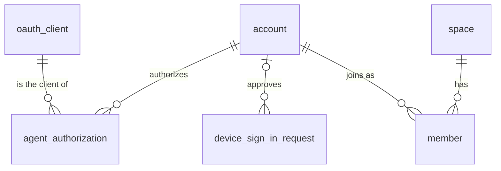

# Data Model

- **Status:** Proposed
- **Level:** Implementation
- **Parent:** [Storage](storage.md)
- **Related:** [Identity](identity.md),
  [Access control](../contracts/access-control.md),
  [Library data model](../../lib/docs/architecture/data-model.md)

> Space member rows hold only people. An agent's spaces and role are derived
> from its person on every request, never stored.
>
> Lorebay's tables refer to the library's only through `space`; no library
> table refers to Lorebay's.

## 1. Purpose

This doc defines Lorebay's own tables: their columns, their constraints,
the rules they keep, and the SQL that creates them. The library's tables,
which share Lorebay's database, are in
[Library data model](../../lib/docs/architecture/data-model.md).

## 2. Scope

This doc covers Lorebay's eight tables: `account` and `member`, and the
six tables only the authorization implementation uses,
`agent_authorization`, `login_session`, `oauth_code`, `oauth_client`,
`refresh_token_history` and `device_sign_in_request`. Behavior observable
through the APIs is in the contract docs.

It does not cover:

- the table in which the migration tool records which of Lorebay's
  migrations have run; the tool maintains it.

## 3. Conventions

- **Lorebay's tables keep the library's
  [conventions](../../lib/docs/architecture/data-model.md#3-conventions)**
  for names, types, times, primary keys, statuses and case-insensitive
  uniqueness, without its two exceptions: their names carry no prefix, and
  every reference between tables is a declared foreign key, the one from
  `member` to the library's `space` included. `oauth_code.client_id`
  is the one exception ([section 5.4](#54-oauth_code)).
- **Table names avoid SQL reserved words.** `user` and `authorization` are
  reserved in Postgres, so the tables are `account` and
  `agent_authorization`. The latter also tells an agent's credential apart
  from a person's login session.
- **A person's ID is `account.id`.** It is the person ID Lorebay gives the
  library, which stores it with no foreign key.
- **Random IDs remain separate from primary keys.** The login session and
  agent authorization keep their 128-random-bit `random_id` columns, which
  name them in access tokens; a primary key never appears in a token.
- **Refresh tokens and authorization codes are stored only as SHA-256
  hashes.** The raw value is returned once, when it is issued. Access tokens
  are signed and not stored; see [Identity](identity.md#7-tokens).
- **Foreign key checks are on** for every SQLite connection, through
  `PRAGMA foreign_keys`.
- **Schema changes are numbered migration files**, embedded in the
  executable. At startup `lorebayd` runs the library's migrations not yet
  run, then its own, in order.

## 4. How the tables relate



`space` is the library's table; every other table here is Lorebay's.
Space members belong to a space; the seven account and authorization tables
belong to no space.

## 5. Accounts and authorization

### 5.1 `account`

A mirror of the users file, synced at startup.

| Column | Type | Constraints | Meaning |
| --- | --- | --- | --- |
| `id` | TEXT | Primary key, not null | |
| `username` | TEXT | Not null, unique | The username in the users file |
| `deleted_at` | INTEGER | Nullable | When the username was removed from the file; empty while it is there |
| `created_at` | INTEGER | Not null | When the first sync added it |

- **Password hashes stay out of the database**, only in the users file.
- **Startup sync.** A username in the file but not in the table gets a row.
  A row whose username left the file gets `deleted_at`, and its
  `member`, `agent_authorization` and `login_session` rows and its
  `oauth_code` rows are deleted. A deleted row whose username is
  back in the file gets `deleted_at` cleared: it is the same person. What
  that means for the person is in [Identity](identity.md#3-accounts).
- **Rows are never deleted**, so Lorebay's person names interface still
  answers for a removed username, and tasks and proposals still show whose
  they were.

### 5.2 `agent_authorization`

One row per agent; see [Identity](identity.md#6-agent-authorization).

| Column | Type | Constraints | Meaning |
| --- | --- | --- | --- |
| `id` | TEXT | Primary key, not null | |
| `account_id` | TEXT | Not null, foreign key to `account` | The person who authorized |
| `client_id` | TEXT | Not null, foreign key to `oauth_client` | The registered client |
| `name` | TEXT | Not null | The agent name; defaults to the client name, and the person may change it when consenting |
| `random_id` | TEXT | Not null, unique | Names the authorization in its access tokens: 128 random bits, encoded as a string |
| `refresh_token_hash` | TEXT | Not null, unique | |
| `refresh_expires_at` | INTEGER | Not null | |
| `created_at` | INTEGER | Not null | When the person authorized |

- **`(account_id, name)` is unique**, compared exactly. Consent checks
  first, and the constraint catches the rest when the row is created.
  Replacing an agent of the same name is in [section 5.4](#54-oauth_code).
- **Each request** verifies the access token's signature and expiry, finds
  the row by the `random_id` the token names, and checks that the account is
  not deleted. The primary key `id` never appears in a token.
- **A refresh replaces the refresh token.** In one transaction it records
  the replaced hash and its current `refresh_expires_at` in
  [the refresh token history](#56-refresh_token_history), stores the new
  hash, signs an access token and moves `refresh_expires_at` forward.
- **Presenting any unexpired token in the history deletes the row.** The
  deletion commits even though the refresh is refused, whichever `client_id`
  the request names. All of the row's tokens then stop working, and the person
  authorizes the agent again. An expired history entry ends nothing. The
  caller gets the same error as for an unknown refresh token;
  [Identity](identity.md#7-tokens) defines the replay rule.
- **Revoking the authorization or deleting the account deletes the row.**
  Its access tokens then name no row and are rejected. Its refresh token
  history is deleted by cascade. Tasks keep the agent name they copied.
- **A background job removes rows whose refresh token has expired**; see
  [System architecture](system.md#6-background-jobs).

### 5.3 `login_session`

A person's login session, from the web pages or the `lorebay` CLI.

| Column | Type | Constraints | Meaning |
| --- | --- | --- | --- |
| `id` | TEXT | Primary key, not null | |
| `account_id` | TEXT | Not null, foreign key to `account` | The person signed in |
| `random_id` | TEXT | Not null, unique | Names the session in its access tokens: 128 random bits, encoded as a string |
| `refresh_token_hash` | TEXT | Not null, unique | |
| `created_at` | INTEGER | Not null | |
| `expires_at` | INTEGER | Not null | When the refresh token expires |

- **Requests and refreshes** work as for an agent authorization; see
  [section 5.2](#52-agent_authorization). Both the Web API and the token
  endpoint record and check the same refresh token history, and delete the
  row on replay. The person signs in again. A refresh also moves `expires_at`
  forward.
- **A row is deleted on logout and with its account**, cascading to its
  refresh token history. A background job removes expired rows; see
  [System architecture](system.md#6-background-jobs).

### 5.4 `oauth_code`

An authorization code, usable once and retained until its expiry after exchange.

| Column | Type | Constraints | Meaning |
| --- | --- | --- | --- |
| `id` | TEXT | Primary key, not null | |
| `code_hash` | TEXT | Not null, unique | |
| `account_id` | TEXT | Not null, foreign key to `account` | The person who signed in and consented |
| `client_id` | TEXT | Not null | The registered client, or the built-in `lorebay` CLI client |
| `redirect_uri` | TEXT | Not null | Must match when the code is exchanged |
| `code_challenge` | TEXT | Not null | The PKCE S256 challenge |
| `agent_name` | TEXT | Nullable | The agent name the person chose when consenting; empty for a code issued to the `lorebay` CLI |
| `replaces_authorization_id` | TEXT | Nullable, foreign key to `agent_authorization`, set null on delete | The authorization to replace, when the name was taken and the person chose to replace it |
| `created_at` | INTEGER | Not null | |
| `expires_at` | INTEGER | Not null | |
| `exchanged_at` | INTEGER | Nullable | Null until the code is exchanged; remains set after its issued credential ends |
| `agent_authorization_id` | TEXT | Nullable, foreign key to `agent_authorization`, set null on delete | The agent authorization this exchange produced |
| `login_session_id` | TEXT | Nullable, foreign key to `login_session`, set null on delete | The login session this exchange produced for the CLI |

- **Exchanging the code is one transaction.** It deletes the authorization
  being replaced, if any, which ends its tokens; creates the
  `agent_authorization` row; and sets `exchanged_at` and
  `agent_authorization_id` on this row, clearing `replaces_authorization_id`.
- **A code issued to the `lorebay` CLI creates a `login_session` row
  instead**, recording its ID in `login_session_id`, because the CLI signs
  a person in; see
  [Identity](identity.md#5-sign-in). The CLI client is built into `lorebayd`
  and has no `oauth_client` row, so `client_id` is not a foreign key.
- **A matching second exchange deletes only the issued credential.** The
  client, redirect URI and PKCE verifier must match, as
  [Identity](identity.md#7-tokens) specifies. The deletion commits although
  the request returns the error of an unknown code. Another second exchange
  or an expired code deletes nothing. The two issued-owner columns cannot
  both be set. Once an owner is deleted, its reference becomes null while
  `exchanged_at` prevents another exchange from issuing tokens.
- **Expired codes, exchanged or not,** are removed by a background job.

### 5.5 `oauth_client`

The clients registered through Dynamic Client Registration; see
[Identity](identity.md#6-agent-authorization).

| Column | Type | Constraints | Meaning |
| --- | --- | --- | --- |
| `id` | TEXT | Primary key, not null | |
| `client_id` | TEXT | Not null, unique | Generated at registration: 128 random bits, encoded as a string |
| `client_name` | TEXT | Not null | The client name the client registered; the default agent name at consent |
| `metadata` | TEXT | Not null | The registration as accepted, as JSON, with its redirect URIs |
| `created_at` | INTEGER | Not null | |
| `first_authorized_at` | INTEGER | Nullable | When the first agent authorization was issued; null means never authorized |

- **Authorization looks the client up by `client_id`** and checks the
  `redirect_uri` against the registered ones.
- **The first successful authorization is remembered permanently.** The code
  exchange sets `first_authorized_at` in the transaction that creates the
  agent authorization, only when it is null. Revocation, replacement and
  expiry never clear it.
- **Only unused clients are deleted.** The background job removes a client
  older than `unused_client_lifetime_seconds` only when
  `first_authorized_at` is null and no unexpired, unexchanged authorization
  code names it.
  A client that ever had an agent authorization is kept. Registration metadata
  is immutable; a client registers again to change it.

### 5.6 `refresh_token_history`

Each refresh token replaced by a refresh of an agent authorization or login session.

| Column | Type | Constraints | Meaning |
| --- | --- | --- | --- |
| `id` | TEXT | Primary key, not null | |
| `token_hash` | TEXT | Not null, unique | SHA-256 hash of the replaced refresh token |
| `agent_authorization_id` | TEXT | Nullable, foreign key to `agent_authorization`, cascade on delete | The authorization this token belonged to |
| `login_session_id` | TEXT | Nullable, foreign key to `login_session`, cascade on delete | The session this token belonged to |
| `expires_at` | INTEGER | Not null | When the replaced token would have expired |

- **Exactly one owner is set**, enforced by a CHECK constraint. Each owner
  column and `expires_at` have an index. Token lookup uses the unique hash.
- **A refresh records the replaced token's existing expiry**, before moving
  the owner's expiry forward. Later refreshes never extend this entry.
  Both login session refresh endpoints use this table.
- **An unexpired entry identifies a replay**, as
  [section 5.2](#52-agent_authorization) defines. An expired entry never ends
  its owner, even before the background job removes it.
- **The history ends with its owner.** Revocation, logout, account removal,
  replacement, replay and expired-owner cleanup cascade to the history.
  The background job also deletes entries whose `expires_at` has passed,
  bounding history by the refresh token lifetime.

### 5.7 `device_sign_in_request`

A short-lived request to sign the built-in `lorebay` CLI in from another
computer; see [Identity](identity.md#5-sign-in).

| Column | Type | Constraints | Meaning |
| --- | --- | --- | --- |
| `id` | TEXT | Primary key, not null | |
| `device_code_hash` | TEXT | Not null, unique | Hash of the secret device code |
| `user_code_hash` | TEXT | Not null, unique | Hash of the uppercase user code without its separator |
| `status` | TEXT | Not null | `pending`, `approved` or `declined` |
| `account_id` | TEXT | Nullable, foreign key to `account` | Set only when the person approves |
| `created_at` | INTEGER | Not null | When the request was made |
| `expires_at` | INTEGER | Not null | Original expiry; a decision never extends it |
| `poll_interval_seconds` | INTEGER | Not null | Minimum polling interval; each premature poll adds five seconds |
| `last_polled_at` | INTEGER | Nullable | Last pending or premature poll; null before the first poll |

- **Both codes are stored only as hashes.** The user code has eight random
  letters from an alphabet without vowels or easily confused characters,
  displayed with a separator after four letters. The device code has 256
  random bits.
- **A decision updates a pending row once.** Approval sets `account_id`;
  refusal leaves it null. Both preserve the original expiry.
- **Exchanging an approved request is one transaction.** It checks the
  account, creates a `login_session` row and deletes this row. A refused or
  expired request cannot issue a session.
- **Expired rows are removed by the credential cleanup job.** An approved
  row is also deleted when its account is removed.

## 6. Space members

### 6.1 `member`

| Column | Type | Constraints | Meaning |
| --- | --- | --- | --- |
| `id` | TEXT | Primary key, not null | |
| `space_id` | TEXT | Not null, foreign key to the library's `space` | |
| `account_id` | TEXT | Not null, foreign key to `account` | |
| `space_number` | INTEGER | Not null | The number of the member's space, the 1 in `SPACE-1` |
| `role` | TEXT | Not null | `owner`, `admin`, `contributor` or `viewer` |
| `created_at` | INTEGER | Not null | When the person joined |
| `updated_at` | INTEGER | Not null | When the role last changed |

- **`(space_id, account_id)` is unique.** A partial unique index on the rows
  whose role is `owner` allows at most one owner per space. Creating a space
  adds the owner's row in the same write that creates the space; see
  [Library architecture](../../lib/docs/architecture/library.md#8-scope-and-space-numbers).
- **The owner is stored only as a role.** The space member row whose role is
  `owner` is the one record of who owns a space, and showing the owner is
  one lookup in the `member_one_owner` index. The library's
  `space.owner_id` is the scope, which Lorebay sets to one fixed value for
  every space.
- **`space_number` is set when the row is inserted** and never changes,
  because a space's number never does. Creating a space sets it to the
  number Lorebay gives the space; adding a space member sets it to the number
  the library returns when it resolves the space key. No foreign key ties
  it to `space.number`: both insert paths take the number from the library.
- **Lorebay numbers its spaces by the highest number plus one,** read
  through the library inside the write that creates the space; see
  [Library architecture](../../lib/docs/architecture/library.md#8-scope-and-space-numbers).
  Lorebay's write transaction holds the database's write lock, so two
  creations cannot take one number. Highest-plus-one would reuse the number
  of a deleted space; no space can be deleted, so a counter, which would
  need a ninth table of Lorebay's, buys nothing.
- **`(account_id, space_number)` is unique.** A person has one row per
  space, and its index lists a person's memberships after a given space
  number in increasing space number, so Lorebay answers the
  [memberships method](../../lib/docs/architecture/library.md#63-space-roles)
  without reading the library's tables.
- **Only people are stored.** An agent's spaces and role are computed from
  its person on every request: the agents of owners and admins are
  contributors, and other agents have their person's role; see
  [Access control](../contracts/access-control.md#3-space-members).
  "An agent follows its person" thus needs no sync.
- **Removing a space member deletes the row**, and so does deleting the
  account; see [section 5.1](#51-account). Nothing in the library's tables
  changes.
- **The foreign key to `space` is declared in Lorebay's migration**, which
  runs after the library's.

## 7. SQLite DDL

The tables of sections 5 and 6, after all migrations. A table comes after
the tables it references: `oauth_client` before `agent_authorization`, and
`member` last. The library's `space` exists before Lorebay's
migrations run; it is in
[Library data model](../../lib/docs/architecture/data-model.md#7-ddl-on-sqlite).

```sql
-- Every connection turns on foreign key checks: PRAGMA foreign_keys = ON;

CREATE TABLE account (
  id          TEXT NOT NULL PRIMARY KEY,
  username    TEXT    NOT NULL UNIQUE,
  deleted_at  INTEGER,
  created_at  INTEGER NOT NULL
);

CREATE TABLE oauth_client (
  id                   TEXT NOT NULL PRIMARY KEY,
  client_id            TEXT    NOT NULL UNIQUE,
  client_name          TEXT    NOT NULL,
  metadata             TEXT    NOT NULL,
  created_at           INTEGER NOT NULL,
  first_authorized_at  INTEGER
);

CREATE TABLE agent_authorization (
  id                  TEXT NOT NULL PRIMARY KEY,
  account_id          TEXT NOT NULL REFERENCES account (id),
  client_id           TEXT    NOT NULL REFERENCES oauth_client (client_id),
  name                TEXT    NOT NULL,
  random_id           TEXT    NOT NULL UNIQUE,
  refresh_token_hash  TEXT    NOT NULL UNIQUE,
  refresh_expires_at  INTEGER NOT NULL,
  created_at          INTEGER NOT NULL,
  UNIQUE (account_id, name)
);

CREATE TABLE login_session (
  id                  TEXT NOT NULL PRIMARY KEY,
  account_id          TEXT NOT NULL REFERENCES account (id),
  random_id           TEXT    NOT NULL UNIQUE,
  refresh_token_hash  TEXT    NOT NULL UNIQUE,
  created_at          INTEGER NOT NULL,
  expires_at          INTEGER NOT NULL
);

CREATE TABLE refresh_token_history (
  id                      TEXT NOT NULL PRIMARY KEY,
  token_hash              TEXT NOT NULL UNIQUE,
  agent_authorization_id  TEXT REFERENCES agent_authorization (id) ON DELETE CASCADE,
  login_session_id        TEXT REFERENCES login_session (id) ON DELETE CASCADE,
  expires_at              INTEGER NOT NULL,
  CHECK ((agent_authorization_id IS NULL) <> (login_session_id IS NULL))
);
CREATE INDEX refresh_token_history_agent ON refresh_token_history (agent_authorization_id);
CREATE INDEX refresh_token_history_session ON refresh_token_history (login_session_id);
CREATE INDEX refresh_token_history_expiry ON refresh_token_history (expires_at);

CREATE TABLE oauth_code (
  id                      TEXT NOT NULL PRIMARY KEY,
  code_hash               TEXT NOT NULL UNIQUE,
  account_id              TEXT NOT NULL REFERENCES account (id),
  client_id               TEXT NOT NULL,
  redirect_uri            TEXT NOT NULL,
  code_challenge          TEXT NOT NULL,
  agent_name              TEXT,
  replaces_authorization_id  TEXT REFERENCES agent_authorization (id) ON DELETE SET NULL,
  created_at              INTEGER NOT NULL,
  expires_at              INTEGER NOT NULL,
  exchanged_at            INTEGER,
  agent_authorization_id  TEXT REFERENCES agent_authorization (id) ON DELETE SET NULL,
  login_session_id        TEXT REFERENCES login_session (id) ON DELETE SET NULL,
  CHECK (agent_authorization_id IS NULL OR login_session_id IS NULL)
);

CREATE TABLE device_sign_in_request (
  id                     TEXT NOT NULL PRIMARY KEY,
  device_code_hash       TEXT NOT NULL UNIQUE,
  user_code_hash         TEXT NOT NULL UNIQUE,
  status                 TEXT NOT NULL CHECK (status IN ('pending', 'approved', 'declined')),
  account_id             TEXT REFERENCES account (id),
  created_at             INTEGER NOT NULL,
  expires_at             INTEGER NOT NULL,
  poll_interval_seconds  INTEGER NOT NULL,
  last_polled_at         INTEGER
);

CREATE TABLE member (
  id            TEXT    NOT NULL PRIMARY KEY,
  space_id      TEXT    NOT NULL REFERENCES space (id),
  account_id    TEXT    NOT NULL REFERENCES account (id),
  space_number  INTEGER NOT NULL,
  role          TEXT    NOT NULL CHECK (role IN ('owner', 'admin', 'contributor', 'viewer')),
  created_at    INTEGER NOT NULL,
  updated_at    INTEGER NOT NULL,
  UNIQUE (space_id, account_id),
  UNIQUE (account_id, space_number)
);
CREATE UNIQUE INDEX member_one_owner ON member (space_id) WHERE role = 'owner';
```
