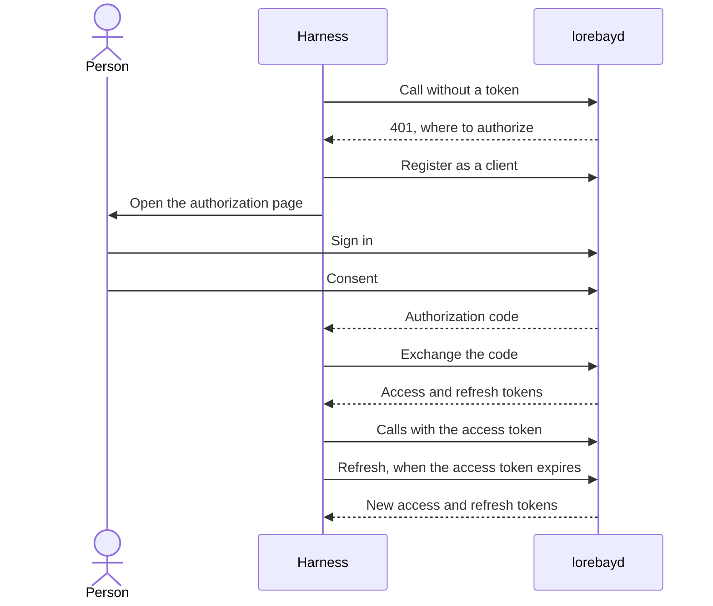

# Identity

- **Status:** Proposed
- **Level:** System
- **Parent:** [System architecture](system.md)
- **Related:** [Access control](../contracts/access-control.md),
  [Web API](../contracts/web-api.md)

> There are exactly two credentials, both bearer tokens: a sign-in for
> a person, and an agent sign-in for one of a person's agents.
>
> Every request checks the token, the account and the sign-in record, and
> the library asks for the person's role, so a removal or revocation takes
> effect on the next request.

## 1. Purpose

People sign in to the web pages and the `lorebay` CLI, and agents act for
them through MCP and the Web API. Lorebay needs to know, on every call, which
person is behind it and, for an agent, which agent sign-in it uses, without
depending on an outside identity service.

## 2. Scope

This doc covers accounts, sign-in, agent sign-in and tokens. What each
role may do is in [Access control](../contracts/access-control.md).

It does not cover:

- sign-in with an emailed code, or adding and removing accounts on the web;
- personal access tokens for CI or other environments without a browser;
- an owner for spaces whose owner's account was deleted;
- client registration through Client ID Metadata Documents;
- cookies: no call is authenticated by one.

## 3. Accounts

- **Accounts live in the users file.** `lorebayd` reads a YAML or JSON users
  file named in its configuration. It holds only usernames and password
  hashes, never plaintext passwords, so reading the file reveals no
  password. `lorebayd` provides a command that produces the hash of a
  password.
- **Adding or removing a user means editing the file and restarting.**
- **Everyone in the file can sign in**, create spaces, and be added to other
  people's spaces.
- **Deleting an account removes the person from every space.** They can no
  longer sign in, and all of their agents' sign-ins stop working. What
  happens to their work is in the library's
  [roles](../../lib/docs/contracts/access-control.md#3-roles).
- **A username added back is the same person.** Their earlier tasks and
  requests are theirs again, but they are in no space until an owner or
  admin adds them, and their agents must authorize again. Never give a
  username to a different person: they would take over the earlier person's
  tasks.

## 4. Credentials

| Credential | Represents | Used for |
| --- | --- | --- |
| Sign-in | A person | Web API, from the web pages and the `lorebay` CLI |
| Agent sign-in | One agent of a person | MCP, Web API |

- **Both credentials are bearer tokens.** Each is an access token and a
  refresh token, and a call carries the access token in its `Authorization`
  header. The web pages, the CLI, external programs and agents then call the
  Web API the same way, and no call needs protection against cross-site
  request forgery.
- **External programs are agents.** A program that calls the Web API
  authorizes through OAuth like an agent, is recorded as one of a person's
  agents, and gets an agent's permissions. There is no third credential.
- **Every caller carries Lorebay's one tenant ID.** Lorebay
  gives every space the same tenant ID, so the library's tenant check never
  hides a space from a Lorebay caller; see
  [Library architecture](../../lib/docs/architecture/library.md#8-tenant-and-space-numbers).
- **Operations only people perform accept only a sign-in**, such as
  approving and rejecting requests, deleting tasks, checkpoints and files,
  changing Knowledge directly, rolling back, and managing space members. The
  full list is in the library's
  [permission matrix](../../lib/docs/contracts/access-control.md#4-permissions)
  and Lorebay's [own rows](../contracts/access-control.md#4-permissions).

## 5. Sign-in

- **A person signs in with a username and password.** Signing in is a Web API
  operation that returns a sign-in. Sign-in is a separate step from
  agent sign-in, so it can move to emailed codes or SSO without
  changing anything on the agent side.
- **Sign-in is rate limited by address.** Too many attempts from one address
  in a short time are refused, which slows password guessing.
- **The `lorebay` CLI signs in through the browser.** The CLI uses a client
  built into `lorebayd`. It starts an authorization code flow with PKCE and a
  redirect to a port on the same computer; the person signs in on the page
  and confirms, and the CLI receives a CLI sign-in for that person. The CLI
  never sees the password. What the terminal shows is in
  [CLI](../contracts/cli.md#4-sign-in-and-credentials).
- **Device sign-in works when the browser is on another computer.** The
  CLI's second sign-in method is the OAuth 2.0 Device Authorization Grant
  of [RFC 8628](https://datatracker.ietf.org/doc/html/rfc8628). It asks for a
  device sign-in request and shows a verification address, a short code and
  a link carrying that code. A person opens the address in any browser,
  signs in and confirms the code; the CLI waits for the decision by polling
  the token endpoint. Only the built-in CLI client may use this grant. Both
  CLI sign-in methods issue a person's CLI sign-in and never create an
  agent sign-in.
- **A device sign-in request expires soon and gives a CLI sign-in once.**
  A request may be approved or declined only once. Approval binds it to the
  person who approved; exchanging it issues that person's CLI sign-in and
  consumes the request in one transaction. A crash leaves either an approved
  request that can still be exchanged or an issued CLI sign-in with a consumed
  request. A declined, expired or consumed request cannot issue a sign-in.
- **Device code issuance and short-code guesses are limited.** Asking for a
  device sign-in request needs no credential and is rate limited by address,
  as sign-in and client registration are. Attempts to read or decide a
  request using a wrong short code are limited too, so the code cannot be
  guessed through the verification page.
- **The verification page asks the person to confirm only a sign-in they
  started.** It says that this signs the `lorebay` CLI in on another computer,
  shows when the request was made and asks the person to check the code,
  including when the link carried it. Like the authorization page, it signs
  the person in, reads the request and submits the decision through Web API
  operations. It keeps its own sign-in only in memory and logs it out
  when finished; that sign-in is separate from the one issued to the CLI.
- **Logging out deletes the sign-in.** Both of its tokens stop working.

## 6. Agent sign-in

- **Lorebay is its own authorization server.** It uses the users file, not
  an outside identity service.
- **Clients register through Dynamic Client Registration.** Lorebay accepts
  MCP clients on several protocol versions; see
  [MCP tools](../../lib/docs/contracts/mcp-tools.md#3-protocol-versions).
  Dynamic Client Registration is the one registration method that all of
  those versions define. Registration is open and needs no credential, as
  [RFC 7591](https://datatracker.ietf.org/doc/html/rfc7591) allows; a
  registered client can do nothing until a person authorizes it.
  Registration is rate limited by address. A background job removes clients
  older than a configurable age that never had an agent sign-in and
  have no authorization code waiting to be exchanged. Together these rules
  keep open registration from filling the database with unused clients.
  A client that ever had an agent sign-in is kept after that
  sign-in ends, because a harness may still use its client ID.
- **An HTTP loopback IP redirect URI matches on any port**, as
  [RFC 8252, section 7.3](https://datatracker.ietf.org/doc/html/rfc8252#section-7.3)
  requires. Its scheme, host, path and query must still match the registered
  URI. Every other redirect URI matches exactly, including `localhost` and
  HTTPS URIs.
  The token request must use the exact redirect URI of its authorization
  request, as [RFC 6749, section 4.1.3](https://datatracker.ietf.org/doc/html/rfc6749#section-4.1.3)
  requires.
- **Sign-in and consent are Web API operations.** The authorization endpoint
  is a minimal page that `lorebayd` serves. The page signs the person in,
  reads the request it was opened with, shows the client and asks for
  consent, and reports the decision, all through the Web API. Richer web
  pages can replace it without changing the operations.
- **Each agent sign-in is one agent.** Its record holds the person, the
  client and a name. The name defaults to the client name the client
  registered, which the client reports about itself and is used only for
  display. When consenting, the person may change it, such as to
  `Claude Code (home)`. The name is at most 100 characters, whether kept from
  the client name or typed at consent, because every record the agent writes
  shows it.
- **A person's agents have distinct names.** When the name chosen at consent
  already belongs to another of the person's agents, the person picks
  another name or replaces the old sign-in. Replacing deletes the old
  record and creates the new one in one transaction when the tokens are
  issued, so the name carries over.
- **An agent follows its sponsor.** It is in every space its sponsor is in,
  and leaves a space when its sponsor does. Its role is derived from its
  sponsor's; see
  [Access control](../contracts/access-control.md#3-space-members).
- **Revoking a sign-in deletes its record.** People see the agents
  they authorized and can revoke any of them. A task keeps the agent name
  copied when it was created, so the name survives revocation.
- **An expired sign-in is removed by a background job.** Its agent
  leaves the person's list of agents, and its name can be used again.

## 7. Tokens

- **Access tokens are signed JWTs.** `lorebayd` signs each one with its
  own key. The token names the person and the sign-in or agent sign-in it
  belongs to, and carries its expiry, so a forged or expired token is
  rejected before any lookup.
- **Every request still loads the record the token names.** A token whose
  sign-in was deleted, or whose account was deleted,
  is rejected, although its signature is valid and it has not expired. The
  library then asks Lorebay for the caller's role, which a removed person no
  longer has.
- **This is how Lorebay meets the library's caller interface.** The
  interface requires that a revoked sign-in, a removed member and a
  deleted person take effect on the next request; see
  [Library architecture](../../lib/docs/architecture/library.md#61-caller).
  Checking the token, the record and the account on every request, and
  answering roles from `member`, meets it.
- **Access tokens expire soon.** A client exchanges its refresh token for a
  new access token.
- **Refresh tokens are random strings**, stored only as hashes. Each
  refresh replaces the current token and remembers its hash until that
  token would have expired. Presenting any remembered, unexpired token
  deletes its sign-in or agent sign-in, so all of its tokens stop working.
  The person signs in or authorizes the agent again. The token alone
  decides, whichever client the request names. Expired tokens end nothing.
  Deleting the record removes its refresh token history.
- **Exchanged authorization codes stay recognizable until their expiry.**
  A second exchange with the same client, the same redirect URI and a PKCE
  verifier matching the code's challenge deletes the sign-in or agent
  sign-in the first exchange produced. Any other second exchange is
  refused and ends nothing. An expired code ends nothing, and a code whose
  sign-in is already gone cannot end another one.
- **There is no grace period for a retry or concurrent exchange.** A client
  that loses a successful response and retries with the replaced refresh
  token, or with the code and its matching verifier, ends its own credential.
  Replay returns the same error as an unknown token or code.

## 8. Authorization flow

When the person revokes the sign-in, its record is deleted and the
agent's next call fails.

## 9. References

- [MCP authorization, 2026-07-28](https://modelcontextprotocol.io/specification/2026-07-28/basic/authorization):
  Dynamic Client Registration stays available for backward compatibility,
  and public clients' refresh tokens must rotate.
- [RFC 6749](https://datatracker.ietf.org/doc/html/rfc6749): OAuth 2.0,
  including exact redirect URI matching during code exchange.
- [RFC 7591](https://datatracker.ietf.org/doc/html/rfc7591): OAuth 2.0
  Dynamic Client Registration.
- [RFC 8252](https://datatracker.ietf.org/doc/html/rfc8252): OAuth 2.0 for
  Native Apps, including loopback redirect ports.
- [RFC 8628](https://datatracker.ietf.org/doc/html/rfc8628): OAuth 2.0 Device
  Authorization Grant, including polling, code guessing and remote phishing.
