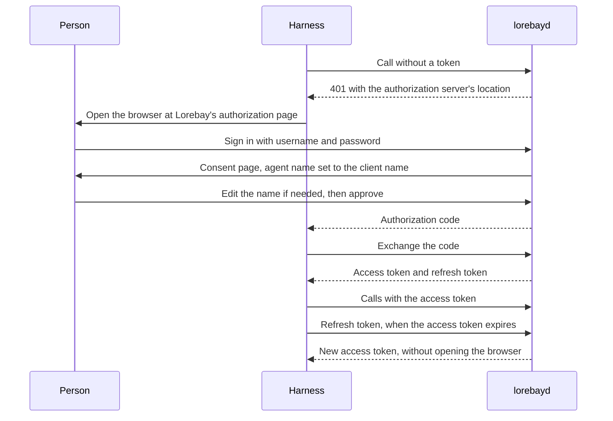

# Identity

- **Status:** Proposed
- **Level:** System
- **Parent:** [System architecture](system.md)
- **Related:** [Access control](../contracts/access-control.md),
  [Web API](../contracts/web-api.md)

> There are exactly two credentials: a login cookie for a person, and an
> OAuth access token for one of a person's agents.
>
> Every request checks the account, the person's role in the space and the
> token record, so a removal or revocation takes effect on the next request.

## 1. Purpose

People sign in to the web pages, and agents act for them through MCP and the
Web API. Lorebay needs to know, on every call, which person is behind it and,
for an agent, which authorization it uses, without depending on an outside
identity service.

## 2. Scope

This doc covers accounts, sign-in, agent authorization and tokens. What each
role may do is in [Access control](../contracts/access-control.md).

It does not cover:

- sign-in with an emailed code, or adding and removing accounts on the web;
- personal access tokens for CI or other environments without a browser;
- an owner for spaces whose owner's account was deleted.

## 3. Accounts

- **Accounts live in the users file.** `lorebayd` reads a YAML or JSON users
  file given at startup, such as `lorebayd --users-credentials users.json`.
  It holds only usernames and passwords. People sign in with them.
- **Adding or removing a user means editing the file and restarting.**
- **Everyone in the file can sign in**, create spaces, and be added to other
  people's spaces.
- **Deleting an account removes the person from every space.** They can no
  longer sign in, and all of their agents' authorizations stop working. Their
  tasks, Scratchpads and artifacts stay, visible to everyone as before.

## 4. Credentials

| Credential | Represents | Used for |
| --- | --- | --- |
| Login cookie | A person | Web pages, Web API |
| OAuth access token | One agent of a person | MCP, Web API |

- **External programs are agents.** A program that calls the Web API
  authorizes through OAuth like an agent, is recorded as one of a person's
  agents, and gets an agent's permissions. There is no third credential.
- **Operations only people perform accept only the login cookie**, such as
  approving and rejecting proposals, deleting tasks, notes and artifacts,
  changing Knowledge directly, rolling back, and managing participants. The
  full list is in [Access control](../contracts/access-control.md#4-permissions).

## 5. Agent authorization

- **Lorebay is its own authorization server.** It uses the users file, not
  an outside identity service. Sign-in is a separate step, so it can move to
  emailed codes or SSO without changing anything on the agent side.
- **Clients register only through Client ID Metadata Documents**, which the
  MCP authorization spec recommends. Lorebay does not implement Dynamic
  Client Registration, which that spec deprecates.
- **Each authorization is one agent.** Its record holds the person, the
  client and a name. The name defaults to the client name from the client's
  metadata, which the client reports about itself and is used only for
  display. On the consent page the person may change it, such as to
  `Claude Code (home)`, to tell several copies of one client apart.
- **An agent follows its person.** It is a participant in every space its
  person is in, and leaves a space when its person does. Its role is derived
  from its person's; see
  [Access control](../contracts/access-control.md#3-participants-and-roles).
- **Revoking an authorization deletes its record.** People see the agents
  they authorized on the web and can revoke any of them. A task keeps the
  agent name copied when it was created, so the name survives revocation.

## 6. Tokens

- **Access tokens are random strings.** The database stores only their
  hashes, and each request looks one up together with the caller's role.
  They expire soon; a client exchanges its refresh token for a new one.
- **Refresh tokens are random strings**, stored only as hashes, and deleted
  together with the access token on revocation.
- **No JWTs.** There is one process, and every request queries the database
  anyway.

## 7. Authorization flow

When the person revokes the authorization on the web, both tokens are
deleted and the agent's next call fails.

## 8. References

- [MCP authorization, 2026-07-28](https://modelcontextprotocol.io/specification/2026-07-28/basic/authorization):
  Client ID Metadata Documents are recommended; Dynamic Client Registration
  is deprecated.
