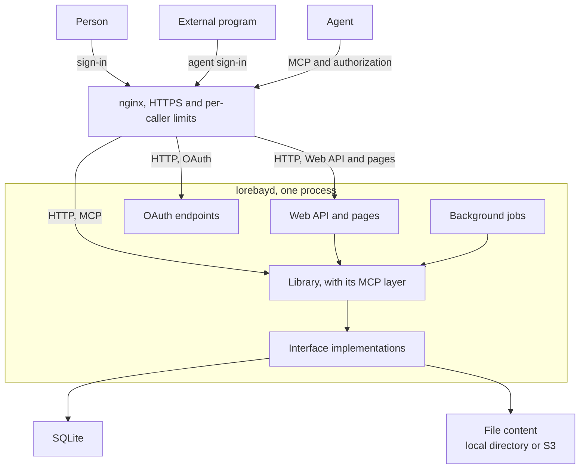

# System Architecture

- **Status:** Proposed
- **Level:** System
- **Parent:** [Lorebay](../product/lorebay.md)
- **Related:** [Storage](storage.md), [Identity](identity.md),
  [Web API](../contracts/web-api.md),
  [Entry points](../../lib/docs/architecture/entry-points.md)

> Lorebay is one `lorebayd` process, holding the library and Lorebay's own
> entry points, identity and jobs.

## 1. Purpose

**One `lorebayd` process holds the product.** It holds the library,
Lorebay's implementations of the library's interfaces, the Web API, the web
pages and the background jobs. A deployment puts nginx in front of it for
HTTPS and per-caller rate limits; `lorebayd` serves plain HTTP privately.

## 2. Scope

This doc covers the process, its entry points and its background jobs. How
every entry point reaches the same library operations is in
[Entry points](../../lib/docs/architecture/entry-points.md); storage is in
[Storage](storage.md), and credentials and sign-in are in
[Identity](identity.md).

It does not cover running several `lorebayd` processes at once. A deployment
runs exactly one.

## 3. Components

**nginx owns HTTPS and per-caller limits.** This keeps TLS and per-caller
policy out of `lorebayd`, with one policy for both deployment methods. The
native deployment runs `lorebayd` under systemd on loopback. nginx consumes
the operator's certificate, streams uploads and downloads, and limits callers
by IPv4 address or IPv6 /64.
The application's limits cover the team's shared proxy peer, keyed on the
TCP peer without reading forwarded headers.

`v0.1.4` keeps file content in a local directory; the S3 backend is
designed but not built ([Storage](storage.md)).

| Caller | Entry point | Credential |
| --- | --- | --- |
| Person, in a browser | Web API and web pages | Sign-in |
| Person, in a terminal | Web API, through the [`lorebay` CLI](../contracts/cli.md) | CLI sign-in |
| External program | Web API | Agent sign-in |
| Agent | MCP | Agent sign-in |

## 4. Entry points

- **One process.** Deploying one `lorebayd` gives the data, the APIs and the
  web pages.
- **The Web API is Lorebay's mapping of the library's operations**, beside
  Lorebay's own operations for sign-in, agents and space members; see
  [Web API](../contracts/web-api.md).
- **The MCP layer is the library's.** `lorebayd` mounts its router and
  answers who is calling through Lorebay's credentials; see
  [Identity](identity.md#4-credentials).
- **File content bypasses MCP and `/api/v1`.** With a local directory,
  `lorebayd` serves the file URLs itself; with S3, once
  [built](storage.md), content goes straight to S3 and never passes through
  `lorebayd`. See [Storage](storage.md#4-file-storage).

## 5. Technology

- **The backend is Rust**, compiled to one executable with the web pages'
  static files embedded in it.

## 6. Background jobs

Background jobs run inside `lorebayd`. Each job must be safe to run again.
They include:

- the library's abandoned-registration and orphaned-file rounds; see
  [Entry points](../../lib/docs/architecture/entry-points.md#4-entry-points);
- removing old temporary uploads and old stored content with out-of-format
  names in the local directory; see [Storage](storage.md#4-file-storage);
- removing expired authorization codes, device sign-in requests, sign-ins
  and agent sign-ins, and replaced refresh tokens past their expiry;
- removing registered clients that were never authorized, once they reach
  a configurable age; see [Identity](identity.md#6-agent-sign-in).
