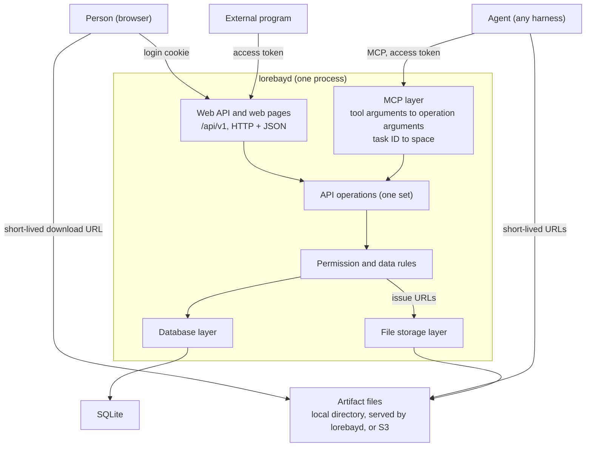

# System Architecture

- **Status:** Proposed
- **Level:** System
- **Parent:** [Lorebay](../product/lorebay.md)
- **Related:** [Storage](storage.md), [Identity](identity.md),
  [MCP tools](../contracts/mcp-tools.md), [Web API](../contracts/web-api.md)

> Lorebay is one `lorebayd` process. Every entry point maps onto one set of
> API operations, and permission and data rules exist once, below them.

## 1. Purpose

People, external programs and agents all reach the same data. Mapping every
entry point onto one set of operations keeps one copy of the permission
rules, so the MCP server and the Web API can never disagree.

## 2. Scope

This doc covers the process, its entry points, its layers and its background
jobs. Storage is in [Storage](storage.md), and credentials and sign-in are
in [Identity](identity.md).

It does not cover running several `lorebayd` processes at once. A deployment
runs exactly one.

## 3. Components

| Caller | Entry point | Credential |
| --- | --- | --- |
| Person, in a browser | Web API and web pages | Login cookie |
| External program | Web API | Access token |
| Agent | MCP | Access token |

## 4. Entry points

- **One process.** Deploying one `lorebayd` gives the data, the APIs and the
  web pages.
- **Entry points only translate protocols.** Permission checks and data rules
  live in the layer below the API operations, written once. The MCP server
  and the Web API check exactly the same way; see
  [Access control](../contracts/access-control.md#6-space-and-task-checks).
- **Every MCP tool maps to one Web API operation.** The MCP layer calls the
  operation in-process, not over the network. See
  [MCP tools](../contracts/mcp-tools.md).
- **Artifact files bypass MCP and `/api/v1`.** A caller first gets a
  short-lived URL, then transfers the file over HTTP. With S3, files go
  straight to S3 and never pass through `lorebayd`. See
  [Storage](storage.md#4-file-storage).

## 5. Technology

- **The backend is Rust**, compiled to one executable with the web pages'
  static files embedded in it.

## 6. Background jobs

Background jobs run inside `lorebayd`. Each job must be safe to run again.
They include:

- removing artifact registrations whose upload was never completed;
- deleting stored files that no database record points to, and temporary
  files left by interrupted uploads;
- removing expired authorization codes and login sessions.
