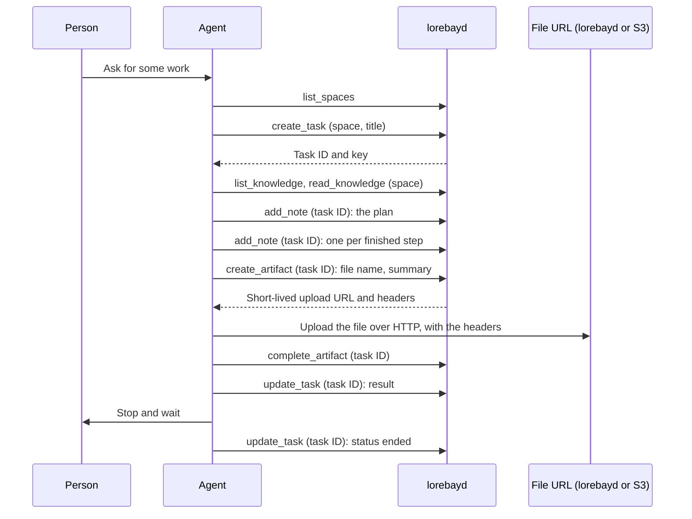

# Agent Skill

- **Status:** Proposed
- **Level:** Contract
- **Parent:** [Lorebay](../product/lorebay.md)
- **Related:** [Tasks](tasks.md), [Knowledge](knowledge.md),
  [MCP tools](mcp-tools.md), [Access control](access-control.md)

> One skill serves every harness.
>
> Where Lorebay has no backstop, the skill is the only enforcement, so the
> skill must state those rules exactly.

## 1. Purpose

Lorebay records what agents choose to send it. Whether a task's record makes
sense, and whether it is complete, depends on agents following these rules.
The skill that ships with Lorebay must state each of them.

A rule's **backstop** is what Lorebay does when an agent doesn't follow it:
whether Lorebay can block or detect the mistake. Seven of the 13 rules have
no backstop and hold only if the skill states them well: rules 1, 4, 5, 9,
10, 12 and 13. Whether a task reads as logical and well organized depends
mostly on rules 5 and 10.

## 2. Scope

This doc covers the rules the skill gives agents, in the order a session
meets them. What Lorebay itself stores and enforces is in the contract docs
the backstops link to.

It does not cover:

- packaging the skill and the MCP connection as a plugin or a marketplace
  listing: people install the skill and connect MCP by hand;
- clients that can connect over MCP but cannot install a skill, such as some
  mobile apps: they are not supported.

## 3. Session start

| # | Rule | Backstop |
| --- | --- | --- |
| 1 | **Choose the space.** If the person is in one space, use it. If the person is in several, the person names the space once per project, and the agent records its key, such as `SPACE-1`, in that project's local instructions; the person may change it at any time. If the person hasn't named one, list the person's spaces, suggest one by name and summary, and use it only after the person confirms. If nobody can confirm, don't guess: don't connect to Lorebay this time, and say why in the output. If the person is in no space, don't connect; tell the person to create a space on the web or ask someone to add them to one. | None |
| 2 | **Create the task.** After the person's first request, check whether it continues earlier work (rule 3), and create a task only if it doesn't. The title is one sentence naming what the person wants done, not how; change it when the scope changes. Every session has a task, even one that only answers questions. There is no task when the agent is a viewer's, when no space could be confirmed, when the person is in no space, when Lorebay is unreachable for the whole session, or when the person says not to record the session; a task already created is then deleted by the person on the web. A subagent is not a separate session: it creates no task, and the main agent writes its work into notes. | Partial: without a task, notes and artifacts cannot be written; see [Tasks](tasks.md#3-tasks) |
| 3 | **Continue a task.** Look for an earlier task only when the person says to continue. List your own party's tasks, which include those created by the person's other agents. If you find it, keep writing to it instead of creating a task; if it is `ended`, set it back to `in progress` first. If none matches, or several look alike, ask the person; don't guess. Someone else's `ended` task may be continued by creating a new task whose result references it, such as `#TK-12`. Someone else's `in progress` task may not be continued: tell the person it is still in progress, and whose it is. A lost task ID, such as after the conversation is compacted, is found the same way: list your own party's tasks that are not `ended`, and pick by title and last activity time, asking the person if unsure. After every write, check the task title in the response to confirm the write went to the right task. If a task you wrote to before is suddenly not found, a person deleted it: tell the person once that the rest of this session goes unrecorded, and don't look for another task. | Partial: `ended` tasks reject notes and artifacts; unknown task IDs and other parties' task IDs are rejected; the ID of another task of your own party passes; a new task that continues someone else's `in progress` task is not blocked. See [MCP tools](mcp-tools.md#6-wrong-task-ids) |
| 4 | **Read Knowledge.** List the top level of the space's Knowledge, go down level by level by name, and read the entries that bear on this work. | None |

## 4. While working

| # | Rule | Backstop |
| --- | --- | --- |
| 5 | **Write notes.** Each session that starts work on the task first writes a plan: what the person wants this time, then how you intend to do it. When a task spans several sessions, these plans mark where each one starts. Reopening an `ended` task also starts with a note: what was missed, and how you will fix it. After each finished step, write a note: what you did, and why. Write no closing note; the conclusion goes in the result. Never write secrets, such as keys, tokens or passwords, into notes. | None; a person can delete a note that holds a secret on the web |
| 6 | **Upload artifacts.** Upload only files you produced that have no other home, such as reports, images, exported documents or data. Files already in a repository or a pull request are not uploaded; link them in Deliverables. Upload with the URL and headers that `create_artifact` returns, then call `complete_artifact`. If the upload returns 412, the file is already uploaded: call `complete_artifact`. | Partial: what gets uploaded is not checked; an upload without the headers, or a second upload to the same URL, is rejected; an upload never reported is not complete. See [Tasks](tasks.md#5-artifacts) |
| 7 | **Write references.** Write them as `#KN-1`. Fix a wrong one where it was written; a note cannot be edited, so append a note that corrects it. | Partial: an unresolvable reference shows as plain text, with no error |
| 8 | **Choose where knowledge goes.** Content about one repository, such as how to build it or its code conventions, stays in that repository's files, such as `CLAUDE.md` or `AGENTS.md`. Content that spans repositories, concerns the team, or is unrelated to code goes into Knowledge. | Partial: anything entering Knowledge needs a person's approval |
| 9 | **Keep working when Lorebay is unreachable**, whether at session start, partway through, or because the authorization stopped working. Don't stop the work, and tell the person once that this stretch is not recorded. Don't backfill it; record as usual once Lorebay is back. | None |

## 5. Stopping and ending

| # | Rule | Backstop |
| --- | --- | --- |
| 10 | **Write the result** in four sections: Deliverables, what was delivered, with links where possible, such as pull requests, commits or artifacts; Decisions, what was decided; Open, what is unresolved; Next, the suggested next step. Leave out any section that would be empty. Update the result each time you finish a stretch and stop to wait for the person, not only when the session ends, and describe the whole piece of work so far, not just the last stretch. When continuing someone else's `ended` task, reference it in the result, such as `#TK-12`, and carry over what is still unresolved in its Open, so a reader needs only the latest task. | None |
| 11 | **Propose Knowledge.** When you stop to update the result and have learned something later sessions can use, first tell the person in the harness what you intend to propose, and submit the proposal only after the person confirms. Without a confirmation, don't propose. Before proposing, check for a `pending` or `rejected` proposal about the same thing: don't repeat a `pending` one; for a `rejected` one, tell the person its reason and let them decide whether to propose again. | Partial: a proposal still needs a person's approval; see [Knowledge](knowledge.md#4-proposals) |
| 12 | **End the task** in three cases: the person says the work is done; the work the person asked for is done and the result has no Open items; or the person switches to unrelated work in the same session. On a switch, end the current task with its unfinished work in Open, then create a new one; if unsure whether it is the same work, stay in the current task. `ended` means only that nobody is working on the task now; whether it is done shows in Open. | None: Lorebay never changes a status on its own; a person can close a task on the web |
| 13 | **Fix missed work in the original task.** When something turns out missing after a task ended, continue in that task instead of creating one. If the person points it out, set the task back to `in progress`; if you notice it yourself, tell the person and reopen it only after they agree. If you are working on another task at the time, end it first, with its unfinished work in Open, so only one task is `in progress` at a time. In a new session, find the original task by rule 3. After reopening, first write a note saying what was missed and how you will fix it; when it is fixed, update the result and end the task. Someone else's task is never reopened: create a new task by rule 3. | None |

## 6. A session

Calls before `create_task` carry no task ID. From then on every call that
writes into the task carries its task ID, and Lorebay checks each one; see
[Access control](access-control.md#6-space-and-task-checks). A session that
continues an earlier task skips `create_task` and finds the task ID with
`list_tasks`, as rule 3 says.
