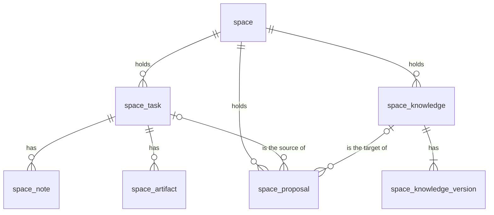

# Data Model

- **Status:** Proposed
- **Level:** Implementation
- **Parent:** [Storage](storage.md)
- **Related:** [Library architecture](library.md),
  [Access control](../contracts/access-control.md),
  [Tasks](../contracts/tasks.md),
  [Knowledge](../contracts/knowledge.md),
  [Keys and references](../contracts/keys-and-references.md)

> The library stores a person only as the product's ID, and refers to no
> product's table.
>
> Primary keys never reach a caller, who sees keys and random task IDs. A
> product receives a space's ID only to refer to the space in its own rows.

## 1. Purpose

This doc defines the library's tables: their columns, their constraints,
the rules they keep, and the SQL that creates them.

## 2. Scope

This doc covers the library's seven tables: `space`, `space_task`,
`space_note`, `space_artifact`, `space_knowledge`,
`space_knowledge_version` and `space_proposal`. Behavior observable through
the public API is in the contract docs, and how the library's migrations
sit beside a product's is in
[Library architecture](library.md#12-data).

It does not cover:

- the table in which the library's migrator records which migrations have
  run, `space_migration`; the migration tool maintains it.

## 3. Conventions

- **Names.** Table names are lowercase English singular nouns; column names
  are snake_case.
- **The library's tables carry the `space_` prefix**, except `space` itself,
  so they never collide with a product's tables in the database they share.
  The prefix is the one exception to the singular-noun rule.
- **Types are only INTEGER and TEXT.** Primary keys and their foreign keys
  are TEXT on both backends. Times, numbers, sizes and versions remain
  INTEGER, declared with the big integer type so Postgres uses BIGINT.
- **Times are UTC milliseconds**, in columns ending in `_at`. A yes-or-no
  fact is a nullable time, never a flag: an empty `deleted_at` means not
  deleted.
- **The application generates every primary key `id` before the insert.**
  It is a UUIDv7 stored as canonical lowercase, hyphenated text: 36
  characters with hexadecimal groups of 8, 4, 4, 4 and 12 digits, version 7
  and the RFC variant. Every primary key is NOT NULL and has no database
  generation or default.
- **Primary keys identify internal rows and break ordering ties.** They
  never define the business order and never reach a caller; a product
  receives a space's ID only to refer to the space in its own rows. Calls use
  public keys, such as `SPACE-1` and `TK-12`, and random task IDs. A space's
  key uses its separate `number`, never its primary key.
- **Random IDs remain separate from primary keys.** A task keeps its
  128-random-bit `random_id`. A UUIDv7's timestamp and fewer random bits
  cannot replace it.
- **Keys.** A table whose rows have keys has a `number` column, unique
  together with `space_id`. The table fixes the prefix: `TK` for
  `space_task`, `KN` for `space_knowledge`, `AR` for `space_artifact` and
  `PP` for `space_proposal`. Numbers come from counters on `space`; see
  [section 5.1](#51-space).
- **Statuses and kinds** are stored as lowercase English values, as the
  contracts write them, with a CHECK constraint, such as `in progress` or
  `ended` for a task's `status`.
- **Case-insensitive uniqueness** uses a second column, `name_key`, holding
  the name in lowercase, with the unique constraint on it. The library
  lowercases in code, not through a database collation, so both backends
  agree and Chinese text is unaffected.
- **Foreign keys are declared** between the library's tables. A product
  using SQLite enables checks on every connection it supplies, as required
  by the [database interface](library.md#64-database). Each table's section
  says what a delete cascades to or clears.
- **Person IDs and the owner ID have no foreign key.** The four columns that
  hold a person, `space_task.person_id`, `space_proposal.proposed_by` and
  `decided_by`, and `space_knowledge_version.applied_by`, and
  `space.owner_id` hold the product's IDs as text. They are the one
  exception to declared foreign keys: the library has no table of people or
  owners, and removing or deleting a person writes nothing here.
- **Keyword search uses `LIKE ? ESCAPE '\'`**, not a full-text index; how
  it matches is in [Storage](storage.md#4-database). Listing Knowledge by
  prefix does not use `LIKE`; see [section 6.1](#61-space_knowledge).
- **References are not stored.** A product resolves `#KN-1` when it shows
  the text.

## 4. How the tables relate



Tasks, knowledge entries and proposals belong to a space; notes and
artifacts belong to a task; each knowledge entry's history is in
`space_knowledge_version`. Who belongs to a space is the product's record;
the library reads it through the
[space roles interface](library.md#63-space-roles).

## 5. Spaces, tasks, notes and artifacts

### 5.1 `space`

| Column | Type | Constraints | Meaning |
| --- | --- | --- | --- |
| `id` | TEXT | Primary key, not null | Internal UUIDv7 |
| `number` | INTEGER | Not null, unique | The number in `SPACE-1`; never reused |
| `owner_id` | TEXT | Not null | The product's owner ID; the scope a caller must carry |
| `name` | TEXT | Not null | Need not be unique |
| `summary` | TEXT | Not null | |
| `next_task_number` | INTEGER | Not null, default 1 | The next `TK` number |
| `next_knowledge_number` | INTEGER | Not null, default 1 | The next `KN` number |
| `next_artifact_number` | INTEGER | Not null, default 1 | The next `AR` number |
| `next_proposal_number` | INTEGER | Not null, default 1 | The next `PP` number |
| `created_at` | INTEGER | Not null | |
| `updated_at` | INTEGER | Not null | When the name or summary last changed |

- **The owner ID is the scope, not a role.** Every operation compares it
  with the caller's scope and answers a space of another owner as not found;
  see [Library architecture](library.md#8-scope-and-space-numbers). Who
  holds the owner role in a space is the product's record.
- **Taking a key.** Creating a task, knowledge entry, artifact or proposal
  adds one to the matching counter and returns the value in one statement,
  inside the same transaction, and uses the value before the increment.
  Taking the current maximum plus one would reuse the keys of deleted
  records.
- **The product gives each space its number.** The unique constraint
  refuses a number already taken, and the library derives the key from it.
  The primary key is generated independently of the number.
- **Spaces are never deleted**, as
  [Library architecture](library.md#2-scope) states, so this table has no
  delete.

### 5.2 `space_task`

| Column | Type | Constraints | Meaning |
| --- | --- | --- | --- |
| `id` | TEXT | Primary key, not null | |
| `space_id` | TEXT | Not null, foreign key to `space` | |
| `number` | INTEGER | Not null | The `TK` number; `(space_id, number)` is unique |
| `random_id` | TEXT | Not null, unique | The task ID: 128 random bits, encoded as a string |
| `person_id` | TEXT | Not null | Whose task it is: the product's person ID, with no foreign key |
| `agent_name` | TEXT | Not null | Copied from the caller at creation |
| `title` | TEXT | Not null | |
| `status` | TEXT | Not null | `in progress` or `ended` |
| `result` | TEXT | Not null, default empty | Markdown, replaced whole on each update |
| `started_at` | INTEGER | Not null | |
| `ended_at` | INTEGER | Nullable | Set when the task becomes `ended`, cleared when it returns to `in progress` |
| `last_activity_at` | INTEGER | Not null | Equal to `started_at` at creation; moved to the time of each note, artifact or result update, never backward |

- **A task names its agent by the copied name**, not by a reference to the
  product's record of the agent. Filtering by agent matches
  `(person_id, agent_name)` with a person filter, or `agent_name` across
  every person without one. Agent names are unique per person, so the
  filter still works after the agent's authorization ends, and an agent
  authorized again under the same name is filtered together with its
  earlier tasks.
- **A person stays an ID.** Showing a task asks the
  [person names interface](library.md#62-person-names) for the name, and a
  person filter asks it for the ID, so a removed or deleted person's tasks
  still show their name and are still found by it.
- **A CHECK ties `ended_at` to `status`**: set when `ended`, empty when
  `in progress`.
- **`(id, space_id)` is unique** so that `space_artifact` can reference a
  task together with its space; see [section 5.4](#54-space_artifact).
- **Deletion is real.** Deleting a task cascades to its notes and artifact
  rows, and clears the source task of its proposals; keys written in text
  stay and show as plain text. The artifact files are deleted after the
  transaction commits; see [Storage](storage.md#4-database).
- **Indexes:** `space_task_space_activity`, on
  `(space_id, last_activity_at)`, to list tasks; `space_task_space_person`,
  on `(space_id, person_id, status)`, to list a party's tasks that are not
  `ended`.
- **Keyword search** covers `title` and `result`.

### 5.3 `space_note`

| Column | Type | Constraints | Meaning |
| --- | --- | --- | --- |
| `id` | TEXT | Primary key, not null | |
| `task_id` | TEXT | Not null, foreign key to `space_task`, cascades on delete | |
| `content` | TEXT | Not null | Markdown |
| `created_at` | INTEGER | Not null | The note's time; strictly increasing within a task |

- **No agent is recorded**, because notes belong to the task; see
  [Tasks](../contracts/tasks.md#3-tasks). Notes are only appended and
  deleted, so there is no `updated_at`.
- **Index:** `space_note_task_time`, on `(task_id, created_at)`, for time
  order and paging.

### 5.4 `space_artifact`

| Column | Type | Constraints | Meaning |
| --- | --- | --- | --- |
| `id` | TEXT | Primary key, not null | |
| `space_id` | TEXT | Not null, foreign key to `space` | The same as its task's space |
| `task_id` | TEXT | Not null; `(task_id, space_id)` is a foreign key to `space_task`, cascades on delete | |
| `number` | INTEGER | Not null | The `AR` number; `(space_id, number)` is unique |
| `file_name` | TEXT | Not null | |
| `summary` | TEXT | Not null | |
| `storage_key` | TEXT | Not null, unique | The file's location, a UUIDv7 generated by the library |
| `size` | INTEGER | Nullable | Bytes, read from storage when the upload is reported complete |
| `created_at` | INTEGER | Not null | When the artifact was registered |
| `completed_at` | INTEGER | Nullable | When the upload was reported complete; until then the artifact is not listed among the task's artifacts |
| `refused_at` | INTEGER | Nullable | When a report found the file over the size limit; a refused artifact is never completed |

- **The key is taken at registration**, and `complete_artifact` names the
  artifact by it. The abandoned-registration round removes registrations
  neither completed nor refused; their keys stay unused.
- **A refused registration stays until its task is deleted**, so a later
  report answers `artifact.refused`. Its `storage_key` holds no file: the
  orphaned-file round does not count it as a record; see
  [Library architecture](library.md#9-files).
- **The library generates `storage_key`**, never from the file name, so
  files with the same name never overwrite each other; see
  [Storage](storage.md#3-file-storage).
- **Whether a browser may open the file** follows the extension of
  `file_name`, as [Storage](storage.md#3-file-storage) describes. No type
  is stored.
- **`space_id` is here** for key uniqueness and space checks. The composite
  foreign key `(task_id, space_id)` keeps it equal to the task's space. A
  CHECK allows `size` only once the upload is complete, and another forbids
  a registration from being both completed and refused.
- **Index:** `space_artifact_task`, on `task_id`.

## 6. Knowledge and proposals

### 6.1 `space_knowledge`

One row per knowledge entry; its content is in `space_knowledge_version`.

| Column | Type | Constraints | Meaning |
| --- | --- | --- | --- |
| `id` | TEXT | Primary key, not null | |
| `space_id` | TEXT | Not null, foreign key to `space` | |
| `number` | INTEGER | Not null | The `KN` number; `(space_id, number)` is unique |
| `name` | TEXT | Not null | As written, and shown that way |
| `name_key` | TEXT | Not null | `name` in lowercase; `(space_id, name_key)` is unique |
| `latest_version` | INTEGER | Not null | The number of the latest version, the only one agents read |
| `deleted_at` | INTEGER | Nullable | When the entry was deleted; empty if it is not |
| `created_at` | INTEGER | Not null | |
| `updated_at` | INTEGER | Not null | When a version was last added or the entry last renamed |

- **The name lives on this row.** A rename changes only `name` and
  `name_key`: it adds no version and keeps the key, and rolling back never
  restores an old name. The rules for names are in
  [Knowledge](../contracts/knowledge.md#3-knowledge-entries).
- **Names are unique ignoring case**, deleted entries included, through
  `name_key`. Reading by name looks up `name_key` too. A rename that changes
  only the case passes the constraint, because it is the same row; a check
  in code before it must skip the entry itself.
- **Listing by prefix** lowercases the prefix and runs a range query, such as
  `name_key >= 'docs/' AND name_key < 'docs0'` for `docs/`, since `0` is the
  character after `/`. The query uses the `(space_id, name_key)` index and
  needs no escaping. Code splits the rows into this level's entries and the
  next level's prefixes; a level whose entries spell it differently shows as
  the entry with the lowest number spells it. Deleted entries are left out.
  The range compares bytes, so on Postgres `name_key` needs
  `COLLATE "C"`.
- **Search** covers the name and the latest version's summary and content.
- **Deleting marks the row.** `deleted_at` is set and a deletion version is
  added; see [section 6.2](#62-space_knowledge_version).

### 6.2 `space_knowledge_version`

| Column | Type | Constraints | Meaning |
| --- | --- | --- | --- |
| `id` | TEXT | Primary key, not null | |
| `knowledge_id` | TEXT | Not null, foreign key to `space_knowledge` | |
| `version` | INTEGER | Not null | Counts from 1 for each entry; `(knowledge_id, version)` is unique |
| `kind` | TEXT | Not null | `content`, a version with content, or `deletion`, the version that deletes the entry |
| `content` | TEXT | Nullable | Set for a `content` version, empty for a `deletion` |
| `summary` | TEXT | Nullable | The same |
| `applied_by` | TEXT | Not null | The product's ID of who made it take effect: the person who changed the entry directly, or who approved the proposal; no foreign key |
| `proposal_id` | TEXT | Nullable, foreign key to `space_proposal` | The source proposal; empty for a direct change |
| `created_at` | INTEGER | Not null | |

- **Versions are only added.** Creating an entry, changing its content or
  summary, deleting it and rolling back each add a row and point
  `space_knowledge.latest_version` at it.
- **A content version holds the full content and summary**, never a diff. A
  CHECK keeps both set for `content` and both empty for `deletion`. A
  deletion version records who deleted the entry, when, and from which
  proposal; the earlier content stays in older versions.
- **Rolling back** adds a `content` version that copies the content and
  summary of the chosen version. Rolling back to a version from before a
  deletion also clears `deleted_at`, which restores the entry.

### 6.3 `space_proposal`

| Column | Type | Constraints | Meaning |
| --- | --- | --- | --- |
| `id` | TEXT | Primary key, not null | |
| `space_id` | TEXT | Not null, foreign key to `space` | |
| `number` | INTEGER | Not null | The `PP` number; `(space_id, number)` is unique |
| `kind` | TEXT | Not null | `create`, `change` or `delete` |
| `knowledge_id` | TEXT | Nullable, foreign key to `space_knowledge` | Set on submission for a change or a delete; for a create, set on approval to the entry it created or restored |
| `base_version` | INTEGER | Nullable | For a change or a delete, the entry's latest version on submission |
| `new_name` | TEXT | Nullable | Required for a create; for a change, set only to rename |
| `new_summary` | TEXT | Nullable | Required for a create; for a change, set only to change it |
| `new_content` | TEXT | Nullable | The same |
| `proposed_by` | TEXT | Not null | The product's ID of who proposed; no foreign key |
| `proposer_agent_name` | TEXT | Nullable | The agent name, copied, when an agent proposed; empty when a person proposed |
| `from_task_id` | TEXT | Nullable, foreign key to `space_task`, set null on delete | The source task; empty for a proposal a person made, or once the task is deleted |
| `status` | TEXT | Not null | `pending`, `approved` or `rejected` |
| `decided_by` | TEXT | Nullable | The product's ID of who approved or rejected it; no foreign key |
| `decided_at` | INTEGER | Nullable | |
| `reject_reason` | TEXT | Nullable | Required when rejected |
| `created_at` | INTEGER | Not null | |

- **A CHECK per kind.** A create carries a name, a summary and content, and
  no `base_version`. A change carries `knowledge_id` and `base_version`, and
  at least one of name, summary and content. A delete carries `knowledge_id`
  and `base_version`, and none of the three.
- **A CHECK on status.** A `pending` proposal has neither `decided_by` nor
  `decided_at`; any other has both; a `rejected` one has a `reject_reason`.
- **Changed since proposed.** On approval, a `base_version` that differs from
  the entry's `latest_version` marks the proposal, so a product can show the
  difference; so does a create whose name already belongs to an entry. A
  rename adds no version, so it goes undetected.
- **Approving** changes the status and writes `space_knowledge` and
  `space_knowledge_version` in one transaction. Content or summary that a
  change leaves out is copied from the entry's current version; when the
  entry was deleted, it is copied from the last version before the
  deletion, and `deleted_at` is cleared. A change that only renames an entry
  that is not deleted changes `name` and `name_key` and adds no version; on
  a deleted entry it restores the entry as above, adding a copied version.
- **Approving one's own party's proposal.** A contributor may not, so the
  library compares `proposed_by` with the approver; see
  [Knowledge](../contracts/knowledge.md#4-proposals).
- **The source task's space.** The task in `from_task_id` must be in the
  proposal's space. Code ensures it: an agent's proposal takes its
  `space_id` from that task. A composite foreign key like
  `space_artifact`'s cannot work here: when the task is deleted,
  `ON DELETE SET NULL` would clear `space_id` too, which is not null.
- **Indexes:** `space_proposal_space_status`, on
  `(space_id, status, created_at)`, to list proposals by status;
  `space_proposal_knowledge`, on `knowledge_id`, to find the proposals on
  one entry.

## 7. DDL on SQLite

The tables of sections 5 and 6, as the library's migrations build them on
the SQLite backend. A table comes after the tables it references:
`space_proposal` before `space_knowledge_version`.

```sql
CREATE TABLE space (
  id                     TEXT    NOT NULL PRIMARY KEY,
  number                 INTEGER NOT NULL UNIQUE,
  owner_id               TEXT    NOT NULL,
  name                   TEXT    NOT NULL,
  summary                TEXT    NOT NULL,
  next_task_number       INTEGER NOT NULL DEFAULT 1,
  next_knowledge_number  INTEGER NOT NULL DEFAULT 1,
  next_artifact_number   INTEGER NOT NULL DEFAULT 1,
  next_proposal_number   INTEGER NOT NULL DEFAULT 1,
  created_at             INTEGER NOT NULL,
  updated_at             INTEGER NOT NULL
);

CREATE TABLE space_task (
  id                TEXT    NOT NULL PRIMARY KEY,
  space_id          TEXT    NOT NULL REFERENCES space (id),
  number            INTEGER NOT NULL,
  random_id         TEXT    NOT NULL UNIQUE,
  person_id         TEXT    NOT NULL,
  agent_name        TEXT    NOT NULL,
  title             TEXT    NOT NULL,
  status            TEXT    NOT NULL CHECK (status IN ('in progress', 'ended')),
  result            TEXT    NOT NULL DEFAULT '',
  started_at        INTEGER NOT NULL,
  ended_at          INTEGER,
  last_activity_at  INTEGER NOT NULL,
  UNIQUE (space_id, number),
  UNIQUE (id, space_id),
  CHECK ((status = 'ended') = (ended_at IS NOT NULL))
);
CREATE INDEX space_task_space_activity ON space_task (space_id, last_activity_at);
CREATE INDEX space_task_space_person ON space_task (space_id, person_id, status);

CREATE TABLE space_note (
  id          TEXT    NOT NULL PRIMARY KEY,
  task_id     TEXT    NOT NULL REFERENCES space_task (id) ON DELETE CASCADE,
  content     TEXT    NOT NULL,
  created_at  INTEGER NOT NULL
);
CREATE INDEX space_note_task_time ON space_note (task_id, created_at);

CREATE TABLE space_artifact (
  id            TEXT    NOT NULL PRIMARY KEY,
  space_id      TEXT    NOT NULL REFERENCES space (id),
  task_id       TEXT    NOT NULL,
  number        INTEGER NOT NULL,
  file_name     TEXT    NOT NULL,
  summary       TEXT    NOT NULL,
  storage_key   TEXT    NOT NULL UNIQUE,
  size          INTEGER,
  created_at    INTEGER NOT NULL,
  completed_at  INTEGER,
  refused_at    INTEGER,
  UNIQUE (space_id, number),
  FOREIGN KEY (task_id, space_id) REFERENCES space_task (id, space_id) ON DELETE CASCADE,
  CHECK ((completed_at IS NULL) = (size IS NULL)),
  CHECK (refused_at IS NULL OR completed_at IS NULL)
);
CREATE INDEX space_artifact_task ON space_artifact (task_id);

CREATE TABLE space_knowledge (
  id              TEXT    NOT NULL PRIMARY KEY,
  space_id        TEXT    NOT NULL REFERENCES space (id),
  number          INTEGER NOT NULL,
  name            TEXT    NOT NULL,
  name_key        TEXT    NOT NULL,
  latest_version  INTEGER NOT NULL,
  deleted_at      INTEGER,
  created_at      INTEGER NOT NULL,
  updated_at      INTEGER NOT NULL,
  UNIQUE (space_id, number),
  UNIQUE (space_id, name_key)
);

CREATE TABLE space_proposal (
  id                   TEXT    NOT NULL PRIMARY KEY,
  space_id             TEXT    NOT NULL REFERENCES space (id),
  number               INTEGER NOT NULL,
  kind                 TEXT    NOT NULL CHECK (kind IN ('create', 'change', 'delete')),
  knowledge_id         TEXT    REFERENCES space_knowledge (id),
  base_version         INTEGER,
  new_name             TEXT,
  new_summary          TEXT,
  new_content          TEXT,
  proposed_by          TEXT    NOT NULL,
  proposer_agent_name  TEXT,
  from_task_id         TEXT    REFERENCES space_task (id) ON DELETE SET NULL,
  status               TEXT    NOT NULL CHECK (status IN ('pending', 'approved', 'rejected')),
  decided_by           TEXT,
  decided_at           INTEGER,
  reject_reason        TEXT,
  created_at           INTEGER NOT NULL,
  UNIQUE (space_id, number),
  CHECK (
    (kind = 'create' AND base_version IS NULL
      AND new_name IS NOT NULL AND new_summary IS NOT NULL AND new_content IS NOT NULL)
    OR (kind = 'change' AND knowledge_id IS NOT NULL AND base_version IS NOT NULL
      AND (new_name IS NOT NULL OR new_summary IS NOT NULL OR new_content IS NOT NULL))
    OR (kind = 'delete' AND knowledge_id IS NOT NULL AND base_version IS NOT NULL
      AND new_name IS NULL AND new_summary IS NULL AND new_content IS NULL)
  ),
  CHECK (
    (status = 'pending' AND decided_by IS NULL AND decided_at IS NULL)
    OR (status <> 'pending' AND decided_by IS NOT NULL AND decided_at IS NOT NULL)
  ),
  CHECK (status <> 'rejected' OR reject_reason IS NOT NULL)
);
CREATE INDEX space_proposal_space_status ON space_proposal (space_id, status, created_at);
CREATE INDEX space_proposal_knowledge ON space_proposal (knowledge_id);

CREATE TABLE space_knowledge_version (
  id            TEXT    NOT NULL PRIMARY KEY,
  knowledge_id  TEXT    NOT NULL REFERENCES space_knowledge (id),
  version       INTEGER NOT NULL,
  kind          TEXT    NOT NULL CHECK (kind IN ('content', 'deletion')),
  content       TEXT,
  summary       TEXT,
  applied_by    TEXT    NOT NULL,
  proposal_id   TEXT    REFERENCES space_proposal (id),
  created_at    INTEGER NOT NULL,
  UNIQUE (knowledge_id, version),
  CHECK (
    (kind = 'content' AND content IS NOT NULL AND summary IS NOT NULL)
    OR (kind = 'deletion' AND content IS NULL AND summary IS NULL)
  )
);
```
