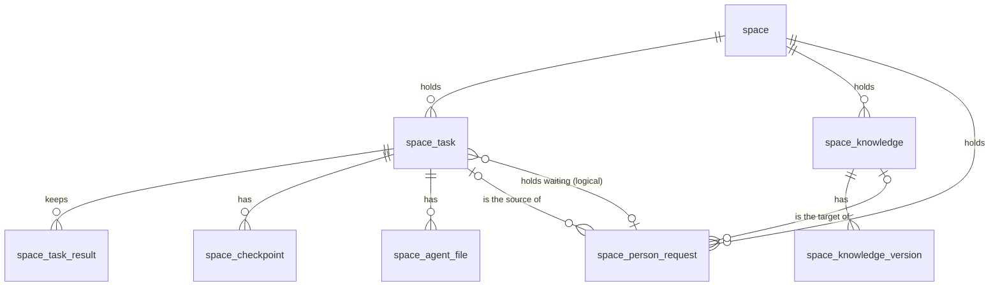

# Data Model

- **Status:** Proposed
- **Level:** Implementation
- **Parent:** [Storage](storage.md)
- **Related:** [Library architecture](library.md),
  [Access control](../contracts/access-control.md),
  [Tasks](../contracts/tasks.md),
  [Knowledge](../contracts/knowledge.md),
  [Keys and references](../contracts/keys-and-references.md)

> The library stores a person only as the product's ID, and refers to no
> product's table.
>
> Primary keys never reach a caller, who sees keys and random task IDs. A
> product receives a space's ID only to refer to the space in its own rows.

## 1. Purpose

This doc defines the library's tables: their columns, their constraints,
the rules they keep, and the SQL that creates them.

## 2. Scope

This doc covers the library's eight tables: `space`, `space_task`,
`space_task_result`,
`space_checkpoint`, `space_agent_file`, `space_knowledge`,
`space_knowledge_version` and `space_person_request`. Behavior observable through
the public API is in the contract docs, and how the library's migrations
sit beside a product's is in
[Library architecture](library.md#12-data).

It does not cover:

- the table in which the library's migrator records which migrations have
  run, `space_migration`; the migration tool maintains it.

## 3. Conventions

- **Names.** Table names are lowercase English singular nouns; column names
  are snake_case.
- **The library's tables carry the `space_` prefix**, except `space` itself,
  so they never collide with a product's tables in the database they share.
  The prefix is the one exception to the singular-noun rule.
- **Types are only INTEGER and TEXT.** Primary keys and their foreign keys
  are TEXT on both backends. Times, numbers, sizes and versions remain
  INTEGER, declared with the big integer type so Postgres uses BIGINT.
- **Times are UTC milliseconds**, in columns ending in `_at`. A yes-or-no
  fact is a nullable time, never a flag: an empty `deleted_at` means not
  deleted.
- **The application generates every primary key `id` before the insert.**
  It is a UUIDv7 stored as canonical lowercase, hyphenated text: 36
  characters with hexadecimal groups of 8, 4, 4, 4 and 12 digits, version 7
  and the RFC variant. Every primary key is NOT NULL and has no database
  generation or default.
- **Primary keys identify internal rows and break ordering ties.** They
  never define the business order and never reach a caller; a product
  receives a space's ID only to refer to the space in its own rows. Calls use
  public keys, such as `SPACE-1` and `TK-12`, and random task IDs. A space's
  key uses its separate `number`, never its primary key.
- **Random IDs remain separate from primary keys.** A task keeps its
  128-random-bit `random_id`. A UUIDv7's timestamp and fewer random bits
  cannot replace it.
- **Keys.** A table whose rows have keys has a `number` column, unique
  together with `space_id`. The table fixes the prefix: `TK` for
  `space_task`, `KN` for `space_knowledge`, `FL` for `space_agent_file` and
  `RQ` for `space_person_request`. Numbers come from counters on `space`; see
  [section 5.1](#51-space).
- **States, statuses, kinds and actions** are stored as lowercase English
  values, as the contracts write them, with a CHECK constraint, such as
  `planned` or `waiting` for a task's `state`.
- **Case-insensitive uniqueness** uses a second column, `name_key`, holding
  the name in lowercase, with the unique constraint on it. The library
  lowercases in code, not through a database collation, so both backends
  agree and Chinese text is unaffected.
- **Foreign keys are declared** between the library's tables. A product
  using SQLite enables checks on every connection it supplies, as required
  by the [database interface](library.md#64-database). Each table's section
  says what a delete cascades to or clears.
- **Person IDs and the tenant ID have no foreign key.** The columns that hold a
  person, `space_task.person_id`, `space_task.planner_person_id`,
  `space_task.state_changed_by`, `space_task_result.person_id`,
  `space_person_request.requested_by` and `decided_by`, and
  `space_knowledge_version.applied_by`, and `space.tenant_id` hold the product's
  IDs as text. The library has no table of people or tenants, and removing or
  deleting a person writes nothing here.
- **The waiting request reference is logical.** `space_task.waiting_request_id`
  has no foreign key because the task and request tables reference each other.
  Submission and decisions check the link under the task lock.
- **Keyword search uses `LIKE ? ESCAPE '\'`**, not a full-text index; how
  it matches is in [Storage](storage.md#4-database). Listing Knowledge by
  prefix does not use `LIKE`; see [section 6.1](#61-space_knowledge).
- **References are not stored.** A product resolves `#KN-1` when it shows
  the text.

## 4. How the tables relate



Tasks, knowledge entries and requests belong to a space; result versions,
checkpoints and files belong to a task; each knowledge entry's history is in
`space_knowledge_version`. Who belongs to a space is the product's record;
the library reads it through the
[space roles interface](library.md#63-space-roles).

## 5. Spaces, tasks, checkpoints and files

### 5.1 `space`

| Column | Type | Constraints | Meaning |
| --- | --- | --- | --- |
| `id` | TEXT | Primary key, not null | Internal UUIDv7 |
| `number` | INTEGER | Not null, unique | The number in `SPACE-1`; never reused |
| `tenant_id` | TEXT | Not null | The product's tenant ID, matched against the caller's |
| `name` | TEXT | Not null | Need not be unique |
| `summary` | TEXT | Not null | |
| `next_task_number` | INTEGER | Not null, default 1 | The next `TK` number |
| `next_knowledge_number` | INTEGER | Not null, default 1 | The next `KN` number |
| `next_agent_file_number` | INTEGER | Not null, default 1 | The next `FL` number |
| `next_person_request_number` | INTEGER | Not null, default 1 | The next `RQ` number |
| `created_at` | INTEGER | Not null | |
| `updated_at` | INTEGER | Not null | When the name or summary last changed |

- **The tenant ID identifies the tenant, not a role.** Every operation
  compares it with the caller's tenant ID and answers a space of another
  tenant as not found; see
  [Library architecture](library.md#8-tenant-and-space-numbers). Who
  holds the owner role in a space is the product's record.
- **Taking a key.** Creating a task, knowledge entry, file or request
  adds one to the matching counter and returns the value in one statement,
  inside the same transaction, and uses the value before the increment.
  Taking the current maximum plus one would reuse the keys of deleted
  records.
- **The product gives each space its number.** The unique constraint
  refuses a number already taken, and the library derives the key from it.
  The primary key is generated independently of the number.
- **Spaces are never deleted**, as
  [Library architecture](library.md#2-scope) states, so this table has no
  delete.

### 5.2 `space_task`

| Column | Type | Constraints | Meaning |
| --- | --- | --- | --- |
| `id` | TEXT | Primary key, not null | |
| `space_id` | TEXT | Not null, foreign key to `space` | |
| `number` | INTEGER | Not null | The `TK` number; `(space_id, number)` is unique |
| `random_id` | TEXT | Not null, unique | The task ID: 128 random bits, encoded as a string |
| `person_id` | TEXT | Not null | Planner's person while planned, then the claiming agent's sponsor |
| `agent_name` | TEXT | Nullable | Holder's copied name, or last holder after work finishes; empty while planned |
| `holder` | TEXT | Nullable | The one agent holding a `working` or `waiting` task, copied by name |
| `planner_person_id` | TEXT | Nullable | Who planned it; set on first release when created started |
| `planner_agent_name` | TEXT | Nullable | Planning agent's copied name, or releasing holder on first release; empty when a person planned it |
| `state_reason` | TEXT | Nullable | One-line reason for `waiting`, `failed` and `canceled` |
| `state_changed_by` | TEXT | Not null | The person who set the current state, or the acting agent's sponsor |
| `state_changed_agent_name` | TEXT | Nullable | Acting agent's copied name; empty when a person set the state |
| `state_changed_at` | INTEGER | Not null | When the current state was set |
| `waiting_request_id` | TEXT | Nullable | Request ID checked under the task lock; empty unless waiting on that request |
| `work_recorded` | INTEGER | Not null, default 0; 0 or 1 | Sticky marker set by a checkpoint, file registration or result write; clearing or deleting content does not clear it |
| `created_at` | INTEGER | Not null | Creation time |
| `title` | TEXT | Not null | |
| `state` | TEXT | Not null | `planned`, `working`, `waiting`, `done`, `failed` or `canceled` |
| `result` | TEXT | Not null, default empty | Latest result text |
| `result_version` | INTEGER | Not null, default 0 | Latest result number; 0 before the first result |
| `started_at` | INTEGER | Nullable | First claim or started creation time |
| `ended_at` | INTEGER | Nullable | Set for `done`, `failed` and `canceled`; cleared on reopen |
| `last_activity_at` | INTEGER | Not null | Creation time initially, then checkpoint, completed file or result time; never moves backward |

- **The holder exists exactly while `working` or `waiting`.** Claims, takeovers,
  releases and state changes update the locked task row. A release clears its
  agent name and restores the planner's party. A started task's first release
  records its current person and the releasing agent as planner.
- **CHECKs bind state, holder, reason and end time.** Only the six states are
  stored; `holder` is set exactly while working or waiting; `state_reason` is
  set exactly for waiting, failed and canceled; `ended_at` is set exactly for
  done, failed and canceled.
- **A waiting request is a logical link.** Submission checks its source task
  under the lock and stores its ID; decisions lock that task before the request
  and clear the link only if it still matches. Requests persist, and task
  deletion clears their `from_task_id`.
- **A task names its agent by the copied name**, not by a reference to the
  product's record of the agent. Filtering by agent matches
  `(person_id, agent_name)` with a person filter, or `agent_name` across
  every person without one. Agent names are unique per person, so the
  filter still works after the agent's authorization ends, and an agent
  authorized again under the same name is filtered together with its
  earlier tasks.
- **A person stays an ID.** Showing a task asks the
  [person names interface](library.md#62-person-names) for the name, and a
  person filter asks it for the ID, so a removed or deleted person's tasks
  still show their name and are still found by it.
- **Planner and state changer names use the same person names interface.**
  The state attribution columns are written with the state, on the locked
  task row.
- **`(id, space_id)` is unique** so that `space_agent_file` can reference a
  task together with its space; see [section 5.5](#55-space_agent_file).
- **Deletion is real.** Task deletion cascades to results, checkpoints and
  files and clears its requests' source task. File content is removed after
  commit; see [Storage](storage.md#4-database).
- **Indexes:** `space_task_space_activity` on `(space_id, last_activity_at)` and
  `space_task_space_person` on `(space_id, person_id, state)` support listing
  and own-open filters.
- **Keyword search** covers `title` and `result`.

### 5.3 `space_task_result`

| Column | Type | Constraints | Meaning |
| --- | --- | --- | --- |
| `id` | TEXT | Primary key, not null | |
| `task_id` | TEXT | Not null, foreign key to `space_task`, cascades on delete | |
| `version` | INTEGER | Not null | Counts from 1 per task; `(task_id, version)` is unique |
| `result` | TEXT | Not null | Whole Markdown result |
| `person_id` | TEXT | Not null | Writing agent's sponsor, resolved through the person names interface |
| `agent_name` | TEXT | Not null | Writing agent's name, copied at the write |
| `created_at` | INTEGER | Not null | |

- **The task row serializes result writes.** Under its lock, the library
  compares the supplied version, takes `result_version + 1`, inserts the
  result row and writes `space_task.result` and `result_version` in the same
  transaction. The result row's time equals the task's last activity time.
- **The unique `(task_id, version)` index supports history paging**, ordered
  by descending version. Each page resolves its writers' person names in bulk.

### 5.4 `space_checkpoint`

| Column | Type | Constraints | Meaning |
| --- | --- | --- | --- |
| `id` | TEXT | Primary key, not null | |
| `task_id` | TEXT | Not null, foreign key to `space_task`, cascades on delete | |
| `agent_name` | TEXT | Not null | Writing agent's name, copied at the write |
| `content` | TEXT | Not null | Markdown |
| `created_at` | INTEGER | Not null | The checkpoint's time; strictly increasing within a task |

- **The writing agent is recorded by name**, independently of the task's
  holder. Checkpoints are only appended and deleted, so there is no
  `updated_at`.
- **Index:** `space_checkpoint_task_time`, on `(task_id, created_at)`, for time
  order and paging.

### 5.5 `space_agent_file`

| Column | Type | Constraints | Meaning |
| --- | --- | --- | --- |
| `id` | TEXT | Primary key, not null | |
| `space_id` | TEXT | Not null, foreign key to `space` | The same as its task's space |
| `task_id` | TEXT | Not null; `(task_id, space_id)` is a foreign key to `space_task`, cascades on delete | |
| `agent_name` | TEXT | Not null | Registering agent's name, copied at registration |
| `number` | INTEGER | Not null | The `FL` number; `(space_id, number)` is unique |
| `file_name` | TEXT | Not null | |
| `summary` | TEXT | Not null | |
| `storage_key` | TEXT | Not null, unique | The file's location, a UUIDv7 generated by the library |
| `size` | INTEGER | Nullable | Bytes, read from storage when the upload is reported complete |
| `created_at` | INTEGER | Not null | When the file was registered |
| `completed_at` | INTEGER | Nullable | When the upload was reported complete; until then the file is not listed among the task's files |
| `refused_at` | INTEGER | Nullable | When a report found the file over the size limit; a refused file is never completed |

- **The key is taken at registration**, and `complete_file` names the
  file by it. The abandoned-registration round removes registrations
  neither completed nor refused; their keys stay unused.
- **A refused registration stays until its task is deleted**, so a later
  report answers `agent_file.refused`. Its `storage_key` holds no stored
  content: the orphaned-file round does not count it as a record; see
  [Library architecture](library.md#9-files).
- **The library generates `storage_key`**, never from the file name, so
  files with the same name never overwrite each other; see
  [Storage](storage.md#3-file-storage).
- **Whether a browser may open the file** follows the extension of
  `file_name`, as [Storage](storage.md#3-file-storage) describes. No type
  is stored.
- **`space_id` is here** for key uniqueness and space checks. The composite
  foreign key `(task_id, space_id)` keeps it equal to the task's space. A
  CHECK allows `size` only once the upload is complete, and another forbids
  a registration from being both completed and refused.
- **Index:** `space_agent_file_task`, on `task_id`.

## 6. Knowledge and requests

### 6.1 `space_knowledge`

One row per knowledge entry; its content is in `space_knowledge_version`.

| Column | Type | Constraints | Meaning |
| --- | --- | --- | --- |
| `id` | TEXT | Primary key, not null | |
| `space_id` | TEXT | Not null, foreign key to `space` | |
| `number` | INTEGER | Not null | The `KN` number; `(space_id, number)` is unique |
| `name` | TEXT | Not null | As written, and shown that way |
| `name_key` | TEXT | Not null | `name` in lowercase; `(space_id, name_key)` is unique |
| `latest_version` | INTEGER | Not null | The number of the latest version, the only one agents read |
| `deleted_at` | INTEGER | Nullable | When the entry was deleted; empty if it is not |
| `created_at` | INTEGER | Not null | |
| `updated_at` | INTEGER | Not null | When a version was last added or the entry last renamed |

- **The name lives on this row.** A rename changes only `name` and
  `name_key`: it adds no version and keeps the key, and rolling back never
  restores an old name. The rules for names are in
  [Knowledge](../contracts/knowledge.md#3-knowledge-entries).
- **Names are unique ignoring case**, deleted entries included, through
  `name_key`. Reading by name looks up `name_key` too. A rename that changes
  only the case passes the constraint, because it is the same row; a check
  in code before it must skip the entry itself.
- **Listing by prefix** lowercases the prefix and runs a range query, such as
  `name_key >= 'docs/' AND name_key < 'docs0'` for `docs/`, since `0` is the
  character after `/`. The query uses the `(space_id, name_key)` index and
  needs no escaping. Code splits the rows into this level's entries and the
  next level's prefixes; a level whose entries spell it differently shows as
  the entry with the lowest number spells it. Deleted entries are left out.
  The range compares bytes, so on Postgres `name_key` needs
  `COLLATE "C"`.
- **Search** covers the name and the latest version's summary and content.
- **Deleting marks the row.** `deleted_at` is set and a deletion version is
  added; see [section 6.2](#62-space_knowledge_version).

### 6.2 `space_knowledge_version`

| Column | Type | Constraints | Meaning |
| --- | --- | --- | --- |
| `id` | TEXT | Primary key, not null | |
| `knowledge_id` | TEXT | Not null, foreign key to `space_knowledge` | |
| `version` | INTEGER | Not null | Counts from 1 for each entry; `(knowledge_id, version)` is unique |
| `kind` | TEXT | Not null | `content`, a version with content, or `deletion`, the version that deletes the entry |
| `content` | TEXT | Nullable | Set for a `content` version, empty for a `deletion` |
| `summary` | TEXT | Nullable | The same |
| `applied_by` | TEXT | Not null | The product's ID of who made it take effect: the person who changed the entry directly, or who approved the request; no foreign key |
| `person_request_id` | TEXT | Nullable, foreign key to `space_person_request` | The source request; empty for a direct change |
| `created_at` | INTEGER | Not null | |

- **Versions are only added.** Creating an entry, changing its content or
  summary, deleting it and rolling back each add a row and point
  `space_knowledge.latest_version` at it.
- **A content version holds the full content and summary**, never a diff. A
  CHECK keeps both set for `content` and both empty for `deletion`. A
  deletion version records who deleted the entry, when, and from which
  request; the earlier content stays in older versions.
- **Rolling back** adds a `content` version that copies the content and
  summary of the chosen version. Rolling back to a version from before a
  deletion also clears `deleted_at`, which restores the entry.

### 6.3 `space_person_request`

| Column | Type | Constraints | Meaning |
| --- | --- | --- | --- |
| `id` | TEXT | Primary key, not null | |
| `space_id` | TEXT | Not null, foreign key to `space` | |
| `number` | INTEGER | Not null | The `RQ` number; `(space_id, number)` is unique |
| `action` | TEXT | Not null | `create`, `change` or `delete` |
| `knowledge_id` | TEXT | Nullable, foreign key to `space_knowledge` | Set on submission for a change or a delete; for a create, set on approval to the entry it created or restored |
| `base_version` | INTEGER | Nullable | For a change or a delete, the entry's latest version on submission |
| `new_name` | TEXT | Nullable | Required for a create; for a change, set only to rename |
| `new_summary` | TEXT | Nullable | Required for a create; for a change, set only to change it |
| `new_content` | TEXT | Nullable | The same |
| `requested_by` | TEXT | Not null | The product's ID of who proposed; no foreign key |
| `requester_agent_name` | TEXT | Nullable | The agent name, copied, when an agent proposed; empty when a person proposed |
| `from_task_id` | TEXT | Nullable, foreign key to `space_task`, set null on delete | The source task; empty for a request a person made, or once the task is deleted |
| `status` | TEXT | Not null | `pending`, `approved` or `rejected` |
| `decided_by` | TEXT | Nullable | The product's ID of who approved or rejected it; no foreign key |
| `decided_at` | INTEGER | Nullable | |
| `reject_reason` | TEXT | Nullable | Required when rejected |
| `created_at` | INTEGER | Not null | |

- **A CHECK per action.** A create carries a name, a summary and content, and
  no `base_version`. A change carries `knowledge_id` and `base_version`, and
  at least one of name, summary and content. A delete carries `knowledge_id`
  and `base_version`, and none of the three.
- **A CHECK on status.** A `pending` request has neither `decided_by` nor
  `decided_at`; any other has both; a `rejected` one has a `reject_reason`.
- **Changed since requested.** While a request is `pending`, a
  `base_version` that differs from the entry's `latest_version` marks the
  request, so a product can show the difference; so does a create whose name
  already belongs to an entry. A rename adds no version, so it goes undetected.
- **Approving** changes the status and writes `space_knowledge` and
  `space_knowledge_version` in one transaction. Content or summary that a
  change leaves out is copied from the entry's current version; when the
  entry was deleted, it is copied from the last version before the
  deletion, and `deleted_at` is cleared. A change that only renames an entry
  that is not deleted changes `name` and `name_key` and adds no version; on
  a deleted entry it restores the entry as above, adding a copied version.
- **Approving one's own party's request.** A contributor may not, so the
  library compares `requested_by` with the approver; see
  [Knowledge](../contracts/knowledge.md#4-requests).
- **The source task's space.** The task in `from_task_id` must be in the
  request's space. Code ensures it: an agent's request takes its
  `space_id` from that task. A composite foreign key like
  `space_agent_file`'s cannot work here: when the task is deleted,
  `ON DELETE SET NULL` would clear `space_id` too, which is not null.
- **Indexes:** `space_person_request_space_status`, on
  `(space_id, status, created_at)`, to list requests by status;
  `space_person_request_knowledge`, on `knowledge_id`, to find the requests on
  one entry.

## 7. DDL on SQLite

The tables of sections 5 and 6, as the library's migrations build them on
the SQLite backend. A table comes after the tables it references:
`space_person_request` before `space_knowledge_version`.

```sql
CREATE TABLE space (
  id                     TEXT    NOT NULL PRIMARY KEY,
  number                 INTEGER NOT NULL UNIQUE,
  tenant_id              TEXT    NOT NULL,
  name                   TEXT    NOT NULL,
  summary                TEXT    NOT NULL,
  next_task_number       INTEGER NOT NULL DEFAULT 1,
  next_knowledge_number  INTEGER NOT NULL DEFAULT 1,
  next_agent_file_number INTEGER NOT NULL DEFAULT 1,
  next_person_request_number   INTEGER NOT NULL DEFAULT 1,
  created_at             INTEGER NOT NULL,
  updated_at             INTEGER NOT NULL
);

CREATE TABLE space_task (
  id                   TEXT    NOT NULL PRIMARY KEY,
  space_id             TEXT    NOT NULL REFERENCES space (id),
  number               INTEGER NOT NULL,
  random_id            TEXT    NOT NULL UNIQUE,
  person_id            TEXT    NOT NULL,
  agent_name           TEXT,
  holder               TEXT,
  planner_person_id    TEXT,
  planner_agent_name   TEXT,
  state_reason         TEXT,
  state_changed_by     TEXT    NOT NULL,
  state_changed_agent_name TEXT,
  state_changed_at     INTEGER NOT NULL,
  waiting_request_id   TEXT,
  work_recorded        INTEGER NOT NULL DEFAULT 0 CHECK (work_recorded IN (0, 1)),
  created_at           INTEGER NOT NULL,
  title                TEXT    NOT NULL,
  state                TEXT    NOT NULL CHECK (state IN ('planned', 'working', 'waiting', 'done', 'failed', 'canceled')),
  result               TEXT    NOT NULL DEFAULT '',
  result_version       INTEGER NOT NULL DEFAULT 0,
  started_at           INTEGER,
  ended_at             INTEGER,
  last_activity_at     INTEGER NOT NULL,
  UNIQUE (space_id, number),
  UNIQUE (id, space_id),
  CHECK ((state IN ('working', 'waiting')) = (holder IS NOT NULL)),
  CHECK ((state IN ('done', 'failed', 'canceled')) = (ended_at IS NOT NULL)),
  CHECK ((state IN ('waiting', 'failed', 'canceled')) = (state_reason IS NOT NULL))
);
CREATE INDEX space_task_space_activity ON space_task (space_id, last_activity_at);
CREATE INDEX space_task_space_person ON space_task (space_id, person_id, state);

CREATE TABLE space_task_result (
  id          TEXT    NOT NULL PRIMARY KEY,
  task_id     TEXT    NOT NULL REFERENCES space_task (id) ON DELETE CASCADE,
  version     INTEGER NOT NULL,
  result      TEXT    NOT NULL,
  person_id   TEXT    NOT NULL,
  agent_name  TEXT    NOT NULL,
  created_at  INTEGER NOT NULL,
  UNIQUE (task_id, version)
);

CREATE TABLE space_checkpoint (
  id          TEXT    NOT NULL PRIMARY KEY,
  task_id     TEXT    NOT NULL REFERENCES space_task (id) ON DELETE CASCADE,
  agent_name  TEXT    NOT NULL,
  content     TEXT    NOT NULL,
  created_at  INTEGER NOT NULL
);
CREATE INDEX space_checkpoint_task_time ON space_checkpoint (task_id, created_at);

CREATE TABLE space_agent_file (
  id            TEXT    NOT NULL PRIMARY KEY,
  space_id      TEXT    NOT NULL REFERENCES space (id),
  task_id       TEXT    NOT NULL,
  agent_name    TEXT    NOT NULL,
  number        INTEGER NOT NULL,
  file_name     TEXT    NOT NULL,
  summary       TEXT    NOT NULL,
  storage_key   TEXT    NOT NULL UNIQUE,
  size          INTEGER,
  created_at    INTEGER NOT NULL,
  completed_at  INTEGER,
  refused_at    INTEGER,
  UNIQUE (space_id, number),
  FOREIGN KEY (task_id, space_id) REFERENCES space_task (id, space_id) ON DELETE CASCADE,
  CHECK ((completed_at IS NULL) = (size IS NULL)),
  CHECK (refused_at IS NULL OR completed_at IS NULL)
);
CREATE INDEX space_agent_file_task ON space_agent_file (task_id);

CREATE TABLE space_knowledge (
  id              TEXT    NOT NULL PRIMARY KEY,
  space_id        TEXT    NOT NULL REFERENCES space (id),
  number          INTEGER NOT NULL,
  name            TEXT    NOT NULL,
  name_key        TEXT    NOT NULL,
  latest_version  INTEGER NOT NULL,
  deleted_at      INTEGER,
  created_at      INTEGER NOT NULL,
  updated_at      INTEGER NOT NULL,
  UNIQUE (space_id, number),
  UNIQUE (space_id, name_key)
);

CREATE TABLE space_person_request (
  id                   TEXT    NOT NULL PRIMARY KEY,
  space_id             TEXT    NOT NULL REFERENCES space (id),
  number               INTEGER NOT NULL,
  action                 TEXT    NOT NULL CHECK (action IN ('create', 'change', 'delete')),
  knowledge_id         TEXT    REFERENCES space_knowledge (id),
  base_version         INTEGER,
  new_name             TEXT,
  new_summary          TEXT,
  new_content          TEXT,
  requested_by          TEXT    NOT NULL,
  requester_agent_name  TEXT,
  from_task_id         TEXT    REFERENCES space_task (id) ON DELETE SET NULL,
  status               TEXT    NOT NULL CHECK (status IN ('pending', 'approved', 'rejected')),
  decided_by           TEXT,
  decided_at           INTEGER,
  reject_reason        TEXT,
  created_at           INTEGER NOT NULL,
  UNIQUE (space_id, number),
  CHECK (
    (action = 'create' AND base_version IS NULL
      AND new_name IS NOT NULL AND new_summary IS NOT NULL AND new_content IS NOT NULL)
    OR (action = 'change' AND knowledge_id IS NOT NULL AND base_version IS NOT NULL
      AND (new_name IS NOT NULL OR new_summary IS NOT NULL OR new_content IS NOT NULL))
    OR (action = 'delete' AND knowledge_id IS NOT NULL AND base_version IS NOT NULL
      AND new_name IS NULL AND new_summary IS NULL AND new_content IS NULL)
  ),
  CHECK (
    (status = 'pending' AND decided_by IS NULL AND decided_at IS NULL)
    OR (status <> 'pending' AND decided_by IS NOT NULL AND decided_at IS NOT NULL)
  ),
  CHECK (status <> 'rejected' OR reject_reason IS NOT NULL)
);
CREATE INDEX space_person_request_space_status ON space_person_request (space_id, status, created_at);
CREATE INDEX space_person_request_knowledge ON space_person_request (knowledge_id);

CREATE TABLE space_knowledge_version (
  id            TEXT    NOT NULL PRIMARY KEY,
  knowledge_id  TEXT    NOT NULL REFERENCES space_knowledge (id),
  version       INTEGER NOT NULL,
  kind          TEXT    NOT NULL CHECK (kind IN ('content', 'deletion')),
  content       TEXT,
  summary       TEXT,
  applied_by    TEXT    NOT NULL,
  person_request_id   TEXT    REFERENCES space_person_request (id),
  created_at    INTEGER NOT NULL,
  UNIQUE (knowledge_id, version),
  CHECK (
    (kind = 'content' AND content IS NOT NULL AND summary IS NOT NULL)
    OR (kind = 'deletion' AND content IS NULL AND summary IS NULL)
  )
);
```
