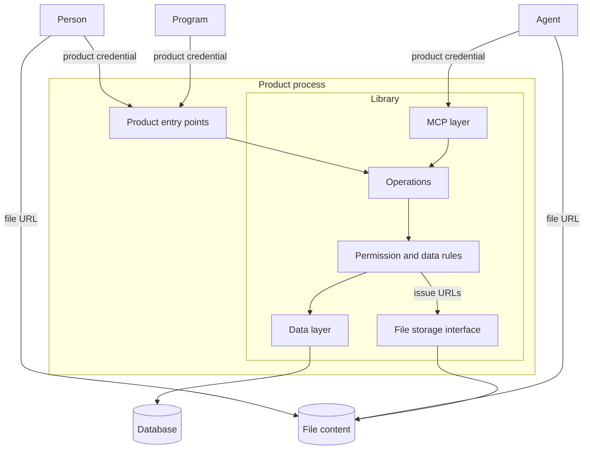

# Entry Points

- **Status:** Proposed
- **Level:** System
- **Parent:** [Library architecture](library.md)
- **Related:** [Storage](storage.md),
  [MCP tools](../contracts/mcp-tools.md),
  [Access control](../contracts/access-control.md)

> Every entry point reaches the same library operations, and the permission
> and data rules exist once, below them.

## 1. Purpose

People, programs and agents all reach the same data, through a product's
own entry points and through the library's MCP layer. Mapping every entry
point onto one set of operations keeps one copy of the permission rules, so
two entry points can never disagree.

## 2. Scope

This doc covers how entry points reach the library's operations, and how
files travel beside them. The boundary between the library and a product is
in [Library architecture](library.md#3-boundary), and storage is in
[Storage](storage.md).

It does not cover how a product schedules the cleanup rounds; the process
and its jobs are the product's.

## 3. Components

## 4. Entry points

- **Entry points only translate protocols.** Permission checks and data
  rules live below the operations, written once. The MCP layer and a
  product's own entry points check exactly the same way; see
  [Access control](../contracts/access-control.md#6-space-and-task-checks).
- **Every MCP tool maps to one library operation.** The MCP layer calls the
  operation in-process, not over the network. See
  [MCP tools](../contracts/mcp-tools.md).
- **A product's entry point calls the same operations.** It verifies its
  own callers, builds the caller and calls the operation, as
  [Library architecture](library.md#61-caller) describes.
- **File content bypasses every entry point.** A caller first gets a
  short-lived URL, then transfers the content over HTTP, straight to the
  product's file storage. See [Storage](storage.md#3-file-storage).
- **Cleanup has no caller.** The two cleanup rounds for file content is
  library functions a product runs on its own schedule; each is safe to run
  again. See [Storage](storage.md#3-file-storage).
