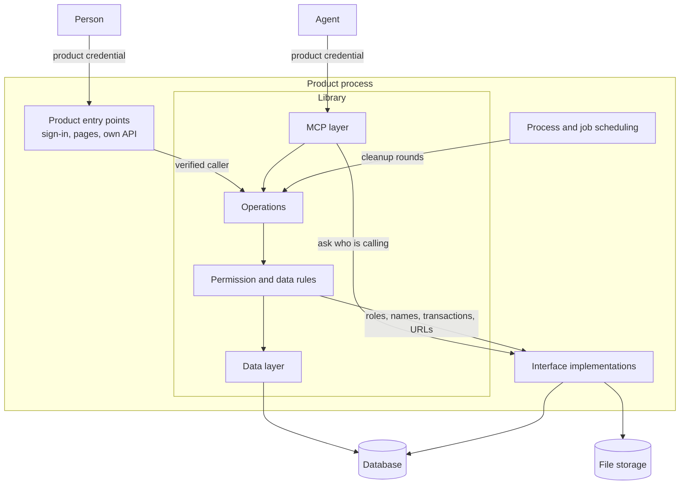
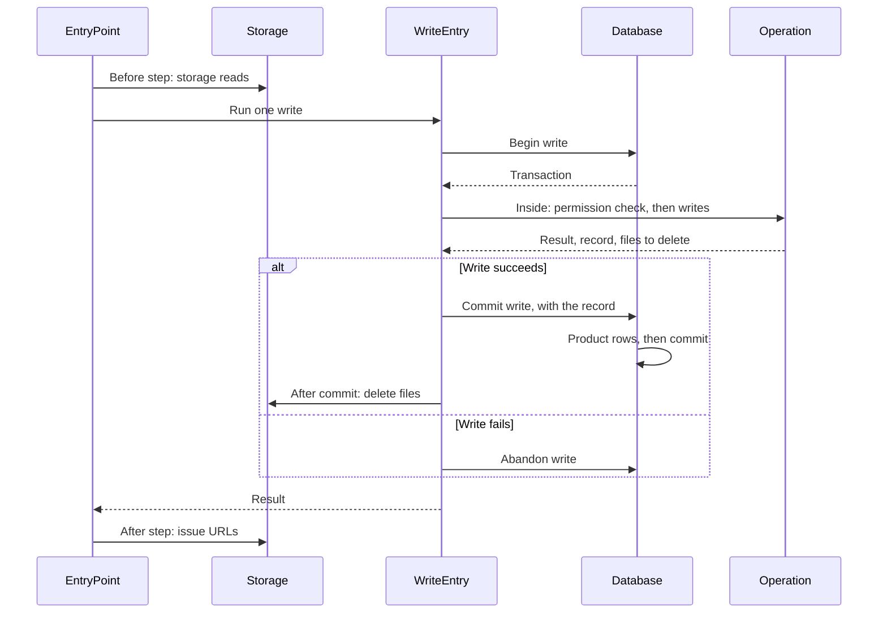

# Library Architecture

- **Status:** Proposed
- **Level:** System
- **Parent:** [Library](../product/library.md)
- **Related:** [Entry points](entry-points.md), [Storage](storage.md),
  [Data model](data-model.md),
  [Access control](../contracts/access-control.md),
  [MCP tools](../contracts/mcp-tools.md)

> The library holds the features every product shares. A product holds
> identity, teams, its entry points and its deployment, and reaches the
> library only through the library's public API and five interfaces.
>
> The library never commits or rolls back the transaction it is handed,
> only a savepoint it opens inside it; it never issues or verifies a
> credential, and names nothing of one product.

## 1. Purpose

A product that wants spaces, tasks, checkpoints, files, Knowledge and the MCP
tools for agents should not have to run a second server beside itself and
repeat identity, teams and storage. The library gives it those features as
Rust crates it builds into its own process, on its own database and file
storage, inside its own transactions and with its own sign-in.

Lorebay is the first product built on the library. It uses the same public
API and the same five interfaces as any other product, so what Lorebay
proves about the boundary holds for a second product.

## 2. Scope

This doc covers what the library holds and what a product holds, the crates,
the public API, the five interfaces a product implements, how writes run and
commit, the settings, the tables, how every write stays correct with
concurrent writers, and how the library is tested on Postgres.

It does not cover:

- deleting a space: no product can delete one;
- an object storage backend, and how one is tested;
- a second product's integration, beyond what the interfaces require;
- how a product maps its own roles to the library's four;
- running one library state across several processes;
- publishing the crates to a registry.

## 3. Boundary

### 3.1 What the library holds

- **Data:** spaces, tasks, checkpoints, the Scratchpad, files, Knowledge and
  proposals, and the keys of each.
- **Rules:** the four roles, owner, admin, contributor and viewer; what each
  may do; the agent's cap at contributor; and the space and task checks
  every operation runs.
- **Operations:** the domain operations on that data, one per row of the
  permission matrix the library owns, and the two cleanup rounds for
  file content.
- **The MCP layer** and its tools, which call the operations.
- **Agent rules:** what an agent follows so that the records it writes
  through the tools make sense, with each rule's backstop, in
  [Agent rules](../contracts/agent-rules.md).
- **Seven tables**, listed in [section 12](#12-data).

### 3.2 What a product holds

- people and how they sign in, the credentials it issues, its
  authorization server and the agents people authorize;
- who belongs to which space with which role, and how memberships change;
- who may create a space, and who owns it afterward;
- its own entry points: its API router with its response and error formats,
  its pages and its command-line tools;
- the file storage backend, and the file URLs it serves;
- its agent skill: each product writes and ships its own skill, which
  states the library's [agent rules](../contracts/agent-rules.md) and the
  product's own, against the tools' contract in
  [MCP tools](../contracts/mcp-tools.md) and the tool descriptions; the
  library ships no skill;
- the process, the scheduling of background jobs, and the deployment.

For Lorebay this is everything outside the library's folder, with Lorebay's
eight tables.

## 4. Crates

The library lives in the top-level folder `lib/`, as four crates, each
in its own subfolder and named `lorebay-lib-<subfolder>`:

| Crate | Folder | Holds | Depends on |
| --- | --- | --- | --- |
| `lorebay-lib-types` | `lib/types/` | The secret type, hash helper, cursor codec and Unix time conversion | No database, MCP or async crate |
| `lorebay-lib-core` | `lib/core/` | Operations, rules, interfaces, settings, result types, data layer, the storage interface | `lorebay-lib-types`, SeaORM |
| `lorebay-lib-migration` | `lib/migration/` | The library schema and its migrator | SeaORM migration |
| `lorebay-lib-mcp` | `lib/mcp/` | The MCP layer, its tools, the MCP authorization challenge and metadata | `lorebay-lib-core`, the MCP SDK, axum |

- **The library has four crates.** A client that needs only the secret type,
  such as a command-line tool, depends on `lorebay-lib-types` and builds no
  database or MCP layer. The MCP crate can call only the core's public
  operations, as a product's entry point does. The migration crate lets a
  product apply the schema separately from building the server or MCP layer.
  A single crate with layer-selecting features would use Cargo features for
  more than driver selection and let MCP code reach core internals.
- **The folder is `lib/` and the crates carry `lib-`.** The folder holds
  the shared library, not one feature of it. A product's workspace may hold
  its own `core` or `mcp` crate, and a name such as `lorebay-core` says
  nothing about which part of Lorebay it belongs to; `lorebay-lib-*` names
  the shared library and stays unique in any workspace that depends on it.
- **The library depends on nothing of a product.** Nothing in `lib/`
  depends on or links to another top-level folder of this repository,
  except the playbook: a doc may link to a fragment, and an `AGENTS.md` may
  import one. The root Cargo workspace settings and the toolchain are
  shared too. A check that `moon ci` runs enforces it.
- **The build tool finds the crates** through a glob in
  `.moon/workspace.yml`, `lib/*/moon.yml`, since `*/moon.yml` matches
  only top-level folders. With
  source-path IDs the projects are `lib/types`, `lib/core`, `lib/migration`
  and `lib/mcp`. They use the `library` layer, which cannot depend on an
  application.

### 4.1 Database backends and dependencies

- **The library picks no backend.** `lorebay-lib-core` has two features,
  `sqlite` and `postgres`, and no default. Each turns on the matching SeaORM
  driver. `lorebay-lib-mcp` forwards those features to core.
  `lorebay-lib-migration` has its own `sqlite` and `postgres` features without
  a default. Consumers select the driver they use. Lorebay selects `sqlite`.
- **Backend features select drivers.** The product supplies the runtime
  connections. Where a statement must differ between the backends, such as
  keyword search, the data layer picks the form from the connection's
  backend at run time, and one build with both features on serves both.
- **Entity generation has its own feature.** The migration crate's
  `entity-generation` feature turns on `sqlite` and builds the entity
  generation helper and binary, which open a disposable SQLite file in
  development. A product that selects `sqlite` builds neither.
- **Versions are declared once,** in the root `[workspace.dependencies]`,
  which declares SeaORM and its migration crate with no driver feature. Its
  entries carry only the features every crate that inherits them needs,
  and each crate adds its own, so a product's choices do not reach the
  library's dependencies.
- **The four crates share one version,** and the boundary check fails when
  they differ. A consumer in another repository pins all library crates it
  uses to the same commit, or to the same release tag once one exists, and
  sets `features = ["postgres"]` or `features = ["sqlite"]` on the crates
  that select a driver. See the
  [manifest example](../../README.md#usage). A second check that `moon ci`
  runs packages the four crates and builds each from its own package, as a
  product outside the repository would.
- **Four dependencies are public.** The public API exposes SeaORM connections
  and transactions, the SeaORM migration trait implemented by `Migrator`,
  `http` request headers, and the axum MCP router. Consumers use compatible
  releases of `sea-orm` and `sea-orm-migration` 2, `http` 1, and `axum` 0.8
  so Cargo can unify those dependencies.

## 5. Public API

The library makes public what a product needs to build its entry points
and its implementations, and nothing more:

- `lorebay-lib-types`: the secret type, whose debug output is redacted,
  `sha256_hex`, the cursor codec shared by list operations, and conversion
  from a caller-supplied `SystemTime` to Unix milliseconds.
- `lorebay-lib-core`:
  - the library state and its settings ([section 11](#11-settings));
  - the five interfaces and the types they exchange
    ([section 6](#6-interfaces));
  - the write entry ([section 7](#7-writes-and-transactions));
  - one function per operation, with its input, result and error types,
    and the steps before and after the write of the operations that call
    storage ([section 7.1](#71-run-one-write));
  - the two cleanup rounds, and the read that checks a download against its
    record;
  - the read of the highest space number
    ([section 8](#8-tenant-and-space-numbers));
  - the read that resolves a space key for a caller, inside the transaction
    it is handed: it checks the tenant, answers a missing space or one of
    another tenant as not found, and returns the space's ID and number
    ([section 7.1](#71-run-one-write)).
- `lorebay-lib-migration`: the library's `Migrator`, which products import
  directly to apply the library schema, and `open_entity_database` with the
  `entity-generation` feature for the disposable database used in entity
  generation
  ([section 12](#12-data)).
- `lorebay-lib-mcp`: one function that returns the router a product
  mounts at the root of its origin.

Entities, repositories and the role checks stay private, so a product
reaches data only through the operations and the reads above.

- **Results are shared, not duplicated.** The operations' result types,
  such as a task with its files or one page of spaces, live in
  `lorebay-lib-core` and serialize to the field names both entry points
  return. The MCP layer serializes them into tool results; a product may
  serialize them in its own responses, as Lorebay does, or map them to its
  own format. Keeping them in a product's router was rejected because the
  MCP layer may not depend on a product, and copying them into the MCP crate
  lets the two entry points drift.
- **Inputs validate themselves.** Input types, such as a task title or a
  checkpoint, check their own length and format when built. Task changes,
  statuses and page sizes have shared validation and field errors. Each entry
  point maps those errors to its protocol. Page sizes and input lengths are
  constants.
- **Public enums and settings can grow.** The error enums, the write
  labels, the settings and the interface set are non-exhaustive: a product
  builds the settings and the interface set with their builders and handles
  variants it does not know, so adding one is not a breaking change.
- **Errors carry codes, not HTTP.** Each area of operations has one error
  enum with no HTTP status and no response body. Each error has a stable
  code, such as `task.not_found`, which the MCP layer puts in the tool error
  and a product may reuse in its own. Library error text names no kind of
  credential; a product's entry point writes the text about its own
  credentials.
- **The hash helper is `sha256_hex`.** It names what it computes, for any
  input. Its output is part of the cursor format and must not change.

## 6. Interfaces

The library defines five interfaces, and the product implements each. All
five are trait objects held in the library state, so the state, the
operations and the MCP layer have one concrete type and no generic
parameter. Each method that waits returns a boxed future. An interface whose
implementations fail in unrelated ways reports failure as one opaque error.

### 6.1 Caller

**Turns a request's credential into a caller.** The MCP layer hands the
interface the request's headers, so the library never parses a credential,
and gets one of three answers: a caller, unauthorized, or an internal
failure.

A **caller** names:

- the person, by the product's ID;
- the agent, when an agent calls: its name, which is unique among the
  person's agents;
- the tenant of the call: a tenant ID ([section 8](#8-tenant-and-space-numbers)).

Every implementation:

- checks the credential on every request, so an agent sign-in
  revoked, a member removed and a person deleted take effect on the next
  request; how long a person stays signed in is the product's rule;
- gives one person's agents distinct names;
- is asked outside any transaction, before the operation starts.

The library issues and verifies no credential. A product's own entry point
verifies its callers in its own way, builds the caller type and calls the
operations; only the MCP layer asks this interface.

### 6.2 Person names

**Names for a batch of person IDs, and the ID for a name.** The library
stores people only as IDs and asks for names when it shows a task or a
proposal, and for an ID when a caller filters by a person's name. When it
returns spaces, it also asks once for the name of the caller's person.

Every implementation:

- gives a name to one person at a time and never to another;
- answers in both directions after the person is removed from a space or
  deleted, so their tasks still show their name and are still found by it;
- answers "none" for an unknown name, not an error.

### 6.3 Space roles

**A person's role in a space, and the person's memberships in a tenant.**
The product keeps memberships wherever it likes: in the library's database,
in its own, or in a directory it asks. The library sees them only through
two methods; no query or table crosses the interface, and the only
database type is the transaction the operation handle carries.

| Method | Takes | Answers |
| --- | --- | --- |
| Role | The operation handle, the person, the space | One of the four roles, or none |
| Memberships | The operation handle, the person, the tenant, the last space number already listed, a limit | Up to the limit of the person's memberships in the tenant with a higher space number, in increasing space number: each a space ID, its number and the role |

- **The operation handle** is the library's own type. It says whether the
  call belongs to a read or a write, and carries the operation's write or
  read transaction, per
  [section 7.2](#72-interfaces-inside-an-operation). An implementation that
  keeps memberships in the library's database reads through it and never
  takes another connection; one that keeps them elsewhere ignores it.
- **The library caps an agent's role** at contributor itself.
- **On a write the implementation may lock** what it reads and hold the
  lock until the commit, through the handle's transaction. The library asks
  for the role before it locks any of its own rows
  ([section 13](#13-concurrent-writers)), so the product's locks always come
  first.
- **Memberships come in space-number order.** The product gives every space
  its number ([section 8](#8-tenant-and-space-numbers)) and a number never
  changes, so the product can keep it with each membership and answer in
  that order. Listing one page of spaces takes two steps: the library asks
  for one more membership than the page size, after the cursor's number,
  then loads those spaces in one statement and drops any that is missing or
  belongs to another tenant. One more membership than the page tells whether
  another page follows; the next cursor is the number of the last membership
  on the page. A page therefore reads at most one page of memberships and
  one page of spaces, however many spaces the person is in. A dropped
  membership makes a page short, never wrong.
- **Every implementation** answers memberships only inside the tenant, in
  strictly increasing space number, and never more than the limit. It
  answers a role and the memberships from the same record, so a space
  listed with a role gives the same role when the person opens it.

**The cost is accepted.** A single statement that joins the memberships
with the spaces would read one page in one step, but it would make every
product keep its memberships in the library's database. Two steps cost one
more round trip per page, and each membership must carry its space's
number. Lorebay keeps it in a `space_number` column on its membership rows,
unique together with the person's ID and set when the row is inserted; both
creating a space and adding a member already know the number. Fetching
roles for
batches of the library's spaces instead was rejected: a person in few of
many spaces would make one page scan them all.

### 6.4 Database

**The transaction of each read and of each write.** The interface has five
methods:

| Method | Does |
| --- | --- |
| Begin read | Opens a transaction for one read |
| End read | Receives the transaction of a read and ends it |
| Begin write | Opens a transaction for one write |
| Commit write | Receives the transaction and the record of the write, or none when the write changed nothing; may add rows of its own, and commits |
| Abandon write | Receives the transaction of a failed write and rolls it back |

- **The product opens, commits and rolls back.** The library writes inside
  the transaction it is handed and never commits or rolls back that
  transaction. It may commit or roll back a savepoint it opens inside it,
  as approving a proposal that creates an entry does when the name is taken.
- **On SQLite the product enables foreign key checks** on every
  connection it hands to the library. Task deletion relies on the cascade
  to its checkpoints and on clearing the source task from proposals.
- **The operation supplies the write label, its caller and its space.** The
  write entry passes the record to the commit hook; only the
  abandoned-registration round's record has no caller. A repeated report of
  a completed upload changes nothing and passes no record, so a product
  never records it as a second change. A product can use the record to add
  its own rows, such as an audit record, for writes from either entry point.
- **A write transaction serializes with every write it could conflict
  with.** On SQLite it takes the write lock before its first statement, the
  immediate mode of the
  [SeaORM rules](../../../playbook/topics/seaorm.md#transactions). On
  Postgres the default isolation suffices, because the library locks the
  rows it reads and then writes.
- **A read sees one state.** A read of several statements, such as a task
  with its checkpoints and files, or a role check and the content it guards,
  runs in one read transaction, as the
  [SeaORM rules](../../../playbook/topics/seaorm.md#transactions) require.
  On SQLite it is a deferred transaction; on Postgres it is a repeatable-read
  transaction, so every statement sees the snapshot of the first. A write
  never commits between two statements of one read.

### 6.5 File storage

**Issues upload and download URLs, reports a file's size, deletes, and
lists.** The library generates each location as a UUIDv7 in the canonical
text form of the [Data model](data-model.md#3-conventions). A backend can
use it as a single path segment or object key.

| Method | Does |
| --- | --- |
| Upload URL | Issues a URL, its method and the headers the upload must carry, expiring when the library says |
| Download URL | Issues a URL that serves the file with the content type and disposition the library chose, expiring when the library says |
| Size | Reports a file's size, or that no file is there |
| Delete | Deletes a file; a missing file is not an error |
| List | Lists each stored file's location and last-modified time |

Every implementation:

- accepts one upload per location and refuses a second, so a file is
  written once;
- refuses an upload without the headers the tool descriptions promise;
- expires its URLs;
- lists only the library's files: the orphaned-file round deletes every
  listed file old enough that no record holds; a refused registration
  holds none ([section 9](#9-files)).

At startup the product gives its storage backend the same upload size limit
it supplies to the library. The backend enforces it when receiving uploads,
and the library checks it again when recording completion. The library
passes URL lifetimes and download presentation with each request to the
backend. The backend removes its own leftovers and lists finished files.

**The storage is a trait object.** A generic parameter was rejected: it
would spread through every operation, the state, the MCP layer and the
product's router. A boxed future per storage call costs nothing next to
the network or disk work behind it.

## 7. Writes and transactions

### 7.1 Run one write

Every library write runs through one entry on the library state, and both
the MCP layer and a product's entry point call operations through it:

- **Every write operation has one shape.** It takes the write the entry
  hands it, names its own caller and space for the record, and returns its
  result. The entry takes no caller of its own, and one write runs exactly
  one library operation, so a product can compose any of them, file
  registration, completion and the abandoned-registration round included,
  with its own rows.
- **Inside, the permission check comes first.** The first statement of
  every write is the check of [section 8](#8-tenant-and-space-numbers) and
  the role. Only the abandoned-registration round, which has no caller, and
  creating a space, whose rule is the product's, start otherwise.
- **After-commit work is handed back.** The inside part returns its result
  together with the files to delete. The entry deletes them only after the
  product's commit succeeds, and drops them after a rollback or a failed
  commit. A deletion that fails is logged and leaves the result unchanged.
  An after-commit deletion that fails or never runs leaves a file no record
  holds, which the orphaned-file round removes.
- **Storage calls run outside the transaction.** An operation that calls
  storage gives the entry point a step before the write, a step after the
  commit, or both: registration returns a value that issues the upload URL
  once the write has committed; completion reads the size in a step before
  the write, decides under the task and file locks, and resolves its
  answer after the commit ([section 9](#9-files)).

  | Operation | Before | Inside | After |
  | --- | --- | --- | --- |
  | Register a file | | Check the task, take the number, insert the registration | Issue the upload URL |
  | Report an upload complete | Check the registration, answer one already refused, and read the stored size | Lock the task and file, recheck the registration, and record completion or the refusal of an oversized file | Delete a refused file |
  | Issue a download URL | Check the space, read the completed record | | Issue the download URL |
  | Delete a task or a file | | Check, then delete the rows | Delete the files |
  | Remove abandoned registrations | | Delete the rows neither completed nor refused | Delete their files |
  | Remove orphaned files | List the files, read which have records | | Delete the files without records |

- **A product may compose its own write** through the same entry, adding
  its rows inside, as it does when it creates a space with its owner's
  membership ([section 8](#8-tenant-and-space-numbers)).
- **A product's writes that write no library table** run in transactions
  it opens itself. Lorebay's sign-in, agent sign-in and membership
  writes keep theirs. Routing them through the entry was rejected: the entry
  exists so that what a product adds holds for every library write, tool
  calls included, and a product's own write is already in its hands.
- **A product's own write in a space resolves the space through the
  library.** Inside its own transaction it calls the library's read that
  resolves a space key for the caller ([section 5](#5-public-api)), which
  checks the tenant and answers not found as every library operation does,
  then checks the caller's role itself and uses the returned space ID for
  its own rows, such as a new membership.

### 7.2 Interfaces inside an operation

An interface called during an operation gets the operation's transaction or
is called outside it, never another connection:

| Interface | Called | Gets |
| --- | --- | --- |
| Caller | Before the operation | The request's headers |
| Space roles | In the permission check, and when listing spaces | The operation handle: the write's or the read's transaction |
| Person names | When a result shows people, or a filter names one | The write's or the read's transaction |
| Database | To begin and end a read, and to begin, commit or abandon a write | |
| File storage | Before or after the transaction | |

- **An implementation uses the connection it is handed.** In a product
  whose database has one connection, as Lorebay's has, an implementation
  that took another while a transaction is open would wait until it timed
  out.
- **Names are looked up in batches:** one call for the people of a page,
  never one per row.

### 7.3 Crashes

A write's rows and a product's rows commit together or not at all. Between
the commit and the after-commit work:

- a crash after registering a file leaves a registration nobody can
  complete, which the abandoned-registration round removes;
- a crash after deleting a task, a file or abandoned registrations
  leaves their content, which the orphaned-file round removes;
- a crash after an oversize refusal and before its deletion leaves the
  file with its refused registration, which no longer holds it; the
  orphaned-file round removes the file, and every later report answers that
  the registration was refused.

Both rounds are safe to run again.

## 8. Tenant and space numbers

- **A space carries a tenant ID** from the product, with no foreign key.
  Creating a space takes it from the tenant of the caller the product
  passes. Lorebay gives every caller one fixed value.
- **The caller carries its tenant**, a tenant ID, from the caller
  interface or from the product's own entry point. Every operation loads
  the space, directly or through the task, compares the space's tenant ID
  with the caller's tenant ID, and answers a space of another tenant, and
  anything in it, as not found, before it asks for the role. Listing spaces
  passes the tenant to the memberships method and returns only spaces of
  that tenant.
- **A product gives each new space its number.** The library refuses a
  number that is not positive as invalid input (`request.invalid_body`,
  field `number`) and a number already used with `space.number_taken`, and
  derives the key in the fixed format, such as `SPACE-1`. The product
  keeps numbers unique and never reuses one.
- **Creating a space is a step a product composes.** It runs inside a write
  the product runs through the entry, because its number, its tenant and the
  owner's membership are the product's. The product authorizes creation,
  supplies the creator's role for the result and adds the membership in
  the same transaction. Lorebay uses the owner role for both the result
  and membership.

## 9. Files

- **The size limit is checked after the upload.** When an upload is
  reported complete, the library reads the file's size before the write
  transaction. Inside the transaction it locks the task and file and
  checks that the registration is neither completed nor refused. A backend
  can also enforce the limit at upload. The completion check covers
  backends that defer it and a limit lowered after the upload.
- **An oversize refusal is a committed write, and final.** If the observed
  size exceeds the limit, the library marks the registration refused and
  commits, then deletes the file, and answers `agent_file.too_large` whether
  or not the deletion succeeds. Every later report of that registration
  answers `agent_file.refused`, so no file at its location can ever complete,
  and the client registers a new file at a new location. Rolling the
  refusal back instead would leave the registration open, and a deletion
  delayed past a new upload to the same location could remove a file a
  later report had completed.
- **A refused registration keeps its row but not its content.** The
  orphaned-file round treats its content as having no record, so content whose
  deletion failed is still removed. The abandoned-registration round leaves
  the row, so a late report keeps answering `agent_file.refused`; the row
  goes when its task is deleted.
- **A download URL may outlive its content.** A URL issued before its
  content was deleted may work until it expires or the file is gone.
  Lorebay serves its own file URLs and checks the record on every download,
  through the library's read.

## 10. MCP layer

- **The MCP layer is the library's entry point for agents.** Each tool maps
  to one library operation and adds no logic of its own, beyond converting
  arguments and results.
- **The library serves the `401` and the protected resource metadata.** A
  call whose caller interface answers unauthorized gets a `401` whose
  challenge names the protected resource metadata, and the library serves
  that document, built from the settings, at the path the MCP authorization
  spec derives from the MCP path. A harness discovers where to authorize
  from these two alone, so leaving them to each product would let one get
  them wrong; serving them needs only settings. The authorization server,
  its metadata and its endpoints are the product's.
- **The product mounts one router** at the root of its origin, holding the
  MCP path and the metadata path.

## 11. Settings

The product supplies the library's settings when it builds the library
state:

| Setting | Used for |
| --- | --- |
| The MCP entry's public address and path | Allowed origins, the challenge and the metadata |
| The MCP server's name and version | The server information agents see |
| Where to authorize | The authorization server the metadata names |
| The file size limit | Startup policy for receiving uploads and the check at completion |
| The upload and download URL lifetimes | The URLs storage issues |
| The types a browser may open inline | Download URLs |
| The age after which an incomplete registration is abandoned | The abandoned-registration round |
| The age after which a file without a record is orphaned | The orphaned-file round |

- **Two values come with the call instead:** the number of each new space,
  and its tenant ID, from the caller's tenant.
- **The library checks its settings** when the state is built: both
  cleanup ages must exceed the upload URL lifetime, or a round could remove
  an upload still in flight.
- **Fixed, not configurable:** the permission matrix, task statuses, key
  formats, tool names and arguments, and that a file is written once.
  Page sizes and input lengths are constants, not settings.

## 12. Data

The library has seven tables: `space`, `space_task`, `space_checkpoint`,
`space_agent_file`, `space_knowledge`, `space_knowledge_version` and
`space_proposal`. No library table refers to a product's table.

- **People are IDs.** The library has no table of people. It stores a
  person only as the product's ID, in four columns with no foreign key: a
  task's person, a proposal's proposer and decider, and the person who
  applied a Knowledge version. Removing or deleting a person writes nothing
  in the library.
- **The tenant ID** of a space is text with no foreign key.
- **Two groups of migrations share one database.** The library's migrator
  records its history in its own table, `space_migration`, and a product's
  migrator keeps SeaORM's default table. At startup Lorebay imports the
  library's migrator from `lorebay-lib-migration` and its own from
  `lorebayd-migration`. It applies the library group first and its own
  second in one transaction, before serving.
- **A product's table may refer to a library table,** as Lorebay's
  memberships refer to `space`. The foreign key is declared in the
  product's migration.
- **Each group generates its own entities.** Each migration crate has its own
  entity generation entry. The library builds a disposable SQLite database
  from only its migrations. Lorebay applies both groups and selects only its
  own tables. Generating library entities alongside Lorebay's would duplicate
  the library's models and require hand-editing generated code to remove the
  duplicates. Generated relations stay within their group. A product joins
  its rows to a space through the space ID the library returns. The
  [SeaORM rules](../../../playbook/topics/seaorm.md#entities) describe the
  generation commands and the projection.

## 13. Concurrent writers

Every library write stays correct on SQLite and on Postgres by the locking
rule of the [SeaORM rules](../../../playbook/topics/seaorm.md#transactions):
on SQLite the product's write transaction holds the write lock from its
first statement, so writes run one at a time; on Postgres a write locks
each row it reads and then writes, in the read. Code that runs on both does
both.

- **Locks are taken in one order:** a product's locks, through the roles
  interface, then a task, a proposal, a knowledge entry, a space, and a
  file. No write locks an earlier kind after a later one, so two writes
  never wait on each other in a cycle.
- **A counter is taken in one statement** that adds one to the space's
  counter and returns the value, so concurrent takers queue on the space
  row and none reuses a number.
- **A state check follows the lock.** A write that needs a task to be
  `in progress` or a proposal to be `pending` checks after it holds that
  row.

| Write | Locks, in order | Stays correct because |
| --- | --- | --- |
| Create a space | None | The unique number refuses a second space with the same number |
| Change a space | Space, by its update | Each change sets only its own fields |
| Create a task | Space counter | Concurrent creations take distinct, consecutive numbers |
| Change a task | Task | Status, end time and last activity are computed from the locked row; last activity never moves backward |
| Append a checkpoint | Task | The state is checked under the lock, and the checkpoint's time exceeds the task's last activity and latest checkpoint, so times within a task strictly increase |
| Delete a checkpoint | None | It deletes by task and time; a task's person never changes, so the party check needs no lock; a deleted time stays below the task's last activity and is never given again |
| Delete a task | Task | A registration or checkpoint waiting on the task finds it gone; the files deleted are those of the rows deleted |
| Register a file | Task, then space counter | The state is checked under the lock; numbers are distinct |
| Report an upload complete | Task, then file | A second report of a completed registration returns the existing result and records no change. The first report to refuse an oversized file commits the refusal; a report that read the size before then finds the refusal under the lock and answers `agent_file.refused`, so one deletion is queued. The task's last activity becomes the later of its current value and the completion. |
| Delete a file | None | One statement deletes the row only if complete and returns its location |
| Remove abandoned registrations | Each deleted row | One statement deletes only rows neither completed nor refused when it deletes them and returns their locations; only their content is deleted |
| Remove orphaned files | None | A record commits before any URL for its location exists, and locations are never reused, so a file old enough with no record never gets one; a refused registration never completes, so its content is never needed |
| Change Knowledge directly | Entry, then space counter for a new entry | The next version is computed from the locked entry; the unique name refuses a second entry of one name |
| Submit a proposal | Task, when it names one; then space counter | The task cannot be deleted before the proposal refers to it; the base version is a snapshot by design |
| Approve or reject a proposal | Proposal, then entry, then space counter for a new entry | The status is checked under the lock, so a proposal is decided once |

The oversize refusal uses the size read before taking the locks, and is
final once it commits. A deletion delayed after that commit can remove only
the refused file, or a file uploaded again to the same location, which no
report can complete. A replacement is a new registration at a new
location, so the delayed deletion never reaches a completed file's
content.

The Knowledge and proposal writes follow the same rules.

## 14. Rules for library code

- **The library names nothing of one product.** No identifier in the
  library names a database engine, a storage backend or its temporary
  files, a product's record of people or of memberships, or a kind of
  credential, and no code branches for one product. Three exceptions name
  a database backend. They are the `sqlite` and `postgres` features, the
  code that picks a statement's form by the connection's backend, and the
  disposable SQLite database used for entity generation
  ([section 4.1](#41-database-backends-and-dependencies)).
- **Lorebay uses the same interfaces as any other product.** It has no
  shortcut into the library's internals.
- **A second product must be able to run the library** on Postgres, with
  object storage, inside its own transactions and with its own identity,
  without a change to the library.

## 15. Tests on Postgres

What only Postgres can show, such as two writers racing, and what no
Lorebay entry point can reach (a write the product abandons, another
tenant's space, a space number that is not positive) is tested against
Postgres through the public API of `lorebay-lib-core`, with test
implementations of the interfaces the tested operations call. The tests
keep the [testing rules](../../../playbook/topics/testing.md#black-box) as
they stand:

- **One fixed loopback address.** Postgres listens on a loopback address
  and port that the test helper names in code. It is not Postgres's default
  port, so a developer's own Postgres does not answer the tests. No test
  reads an environment variable.
- **Each test creates its own database** and drops it, so tests stand alone
  and run in parallel.
- **No Postgres fails the tests.** The helper fails with a message that
  says how to start one; no test is skipped.
- **Pull request CI** starts Postgres as a service container of the
  workflow, its image pinned by full version, and the root
  `CONTRIBUTING.md` names the same image for developers.
- **The test build alone turns on `postgres`**, through a dev-dependency.

## 16. References

- [MCP authorization, 2026-07-28](https://modelcontextprotocol.io/specification/2026-07-28/basic/authorization):
  a protected MCP server answers `401` with a challenge that names its
  protected resource metadata.
- [RFC 9728](https://datatracker.ietf.org/doc/html/rfc9728): OAuth 2.0
  Protected Resource Metadata, including the well-known path derived from
  the resource's path.
- [PostgreSQL: explicit locking](https://www.postgresql.org/docs/current/explicit-locking.html):
  row locks taken by `FOR UPDATE` and how read committed transactions wait
  on them.
