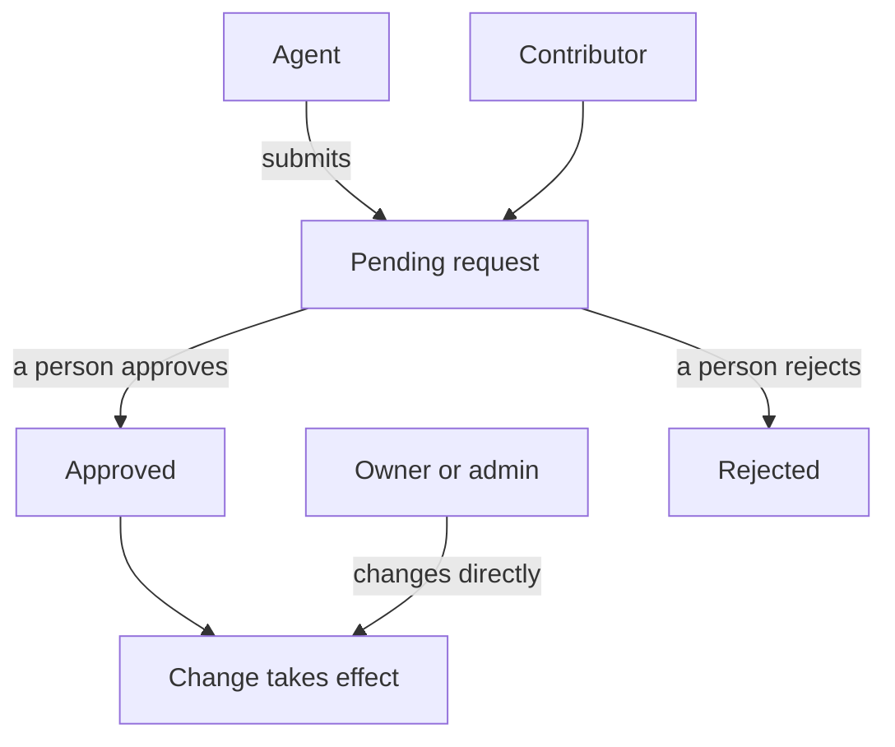

# Knowledge

- **Status:** Proposed
- **Level:** Contract
- **Parent:** [Library](../product/library.md)
- **Related:** [Access control](access-control.md),
  [Data model](../architecture/data-model.md)

> Only owners and admins change Knowledge directly. Every other change is a
> request that takes effect only when a person approves it.
>
> Agents read only the latest version of a knowledge entry.

## 1. Purpose

Knowledge carries what later sessions need, so each new session doesn't
start from nothing. Because every agent in the space reads it, changes stay
under people's control and every version is kept.

## 2. Scope

This doc covers knowledge entries, their versions, and requests. When agents
read Knowledge, what belongs in it, and when agents propose changes are in
[Agent practices](agent-practices.md).

It does not cover requests for anything other than Knowledge, such as
decisions an agent needs from a person in the middle of its work.

## 3. Knowledge entries

- **An entry is Markdown text** with a name, shaped like a file path, and a
  one-sentence summary. Knowledge belongs to the whole space, not to one
  person.
- **Names.** A name is levels separated by `/`, such as `deploy/staging.md`,
  with no `/` at the start or end and no empty level. A level may not be
  `.` or `..`, hold a control character, or start or end with whitespace. An
  extension is only part of the name: `guide.md` and `guide.txt` are two
  entries, and both show as Markdown.
- **Names ignore case.** They are compared ignoring case and shown as
  written, so `Deploy.md` and `deploy.md` are the same name, and reading
  `deploy.md` finds `Deploy.md`. This keeps one topic from splitting into two
  entries that drift apart.
- **Finding entries.** Entries are listed level by level by name prefix, and
  searched by keyword across names, summaries and content. Levels that differ
  only in case are one level, shown as the entry with the lowest key spells
  it.
- **Every version is kept.** A content version stores the content and the
  summary; a deletion version stores neither. People view the history and
  roll back.
- **Agents read only the latest version.** Older versions are kept, but
  agents cannot read them.
- **Rolling back creates a new version** whose content and summary equal the
  chosen old version; the versions in between stay. Rolling back is a change:
  owners and admins roll back directly, and a contributor's rollback is a
  request whose content is the old version.
- **Creating, changing and deleting an entry go through a request**, except
  for owners and admins; see [section 4](#4-requests).
- **Direct changes name the version they replace.** A change, deletion or
  rollback supplies the entry's current version. A mismatch is refused with
  `knowledge.version_changed`, applying nothing. A successful write returns
  the entry's version. Renaming still adds no version.
- **Deleting.** A deletion is recorded as a version, with who deleted the
  entry and when. The content stays in earlier versions, and rolling back
  restores it. Deleted entries are listed separately for people, who can roll
  them back; agents don't see them when listing or searching.
- **Renaming** is a change: owners and admins rename directly, and anyone else
  includes the new name in a change request. A name must be unique within
  the space, deleted entries included: a direct rename to another entry's
  name is rejected, and a request that would rename to another entry's name
  cannot be approved. A rename may change only the case. Renaming keeps the
  key and the history, so references by key still resolve. Renaming an entry
  that is not deleted creates no version, and rolling back never restores an
  old name.

## 4. Requests

- **A request can hold its task in `waiting`.** An agent submitting from its `working` task may ask to wait on it. The task records the request as its reason. Approval, rejection or withdrawal returns it to `working` only while it still waits on that request; another wait or a finished task is unchanged. See [Tasks](tasks.md#31-states).

- **A request** asks to create, change or delete one knowledge entry, and
  takes effect only when approved. Its status is `pending`, `approved` or
  `rejected`.
- **Three actions.** A create carries a name, a summary and content. A change
  carries only the fields it changes, at least one of content, summary and
  name; the rest keep their current values. A delete carries no content.
- **A pending request can be revised.** The requesting party's person or any
  of its agents replaces the supplied content, summary or name. Omitted
  fields keep their proposed values. The revision number starts at 1 and
  rises on every revision; the key stays and no earlier revision is kept.
  Each submission and revision records the target's current version and name.
  An empty revision refreshes that snapshot; a delete takes no replacement
  fields. The action and target entry stay the same.
- **Attribution records both agents.** Reads and lists show the submitting
  agent's copied name and the last revising agent's copied name, empty when
  the corresponding writer was a person. The requesting person, last revising
  person and revision time are also shown; before any revision the latter
  fields are empty.
- **Who must propose.** Everyone except owners and admins, people and agents
  alike, creates, changes and deletes entries through requests. Changes by
  owners and admins take effect directly.
- **Who decides.** Owners, admins and contributors may approve and reject.
  Only people decide; agents can neither approve nor reject. Approval records
  who approved and when. Approval and rejection name the revision the person
  read; a mismatch is refused with `person_request.revision_changed`, applying
  nothing.
- **Approving one's own.** For approval, a person and the agents they sponsor
  are one party. Owners and admins may approve their own party's requests. A
  contributor may not, whether the contributor or one of their agents
  proposed it; another person must approve it. Rejecting is not limited: a
  person may reject their own party's request, which withdraws it, and must
  give a reason.
- **Outdated requests cannot be approved.** A pending request is outdated
  when the target's current version or name differs from its recorded
  snapshot, or a create's name belongs to any entry, deleted entries included.
  Reads and lists show `outdated` while pending. Approval refuses it with
  `person_request.outdated`, applying nothing. After reading and reconciling
  the current entry, revise the request to refresh its snapshot; a create
  needs an available name. Outdated is a mark, not a status.
- **A change targeting a deleted entry restores it** when approved against
  that deletion's version and name. Content or summary it omits comes from the
  last content version. A create never replaces an existing entry.
- **Rejecting.** The person who rejects writes a reason. Rejected requests
  are kept, with the content, the requester, who rejected them and the reason,
  visible to everyone.
