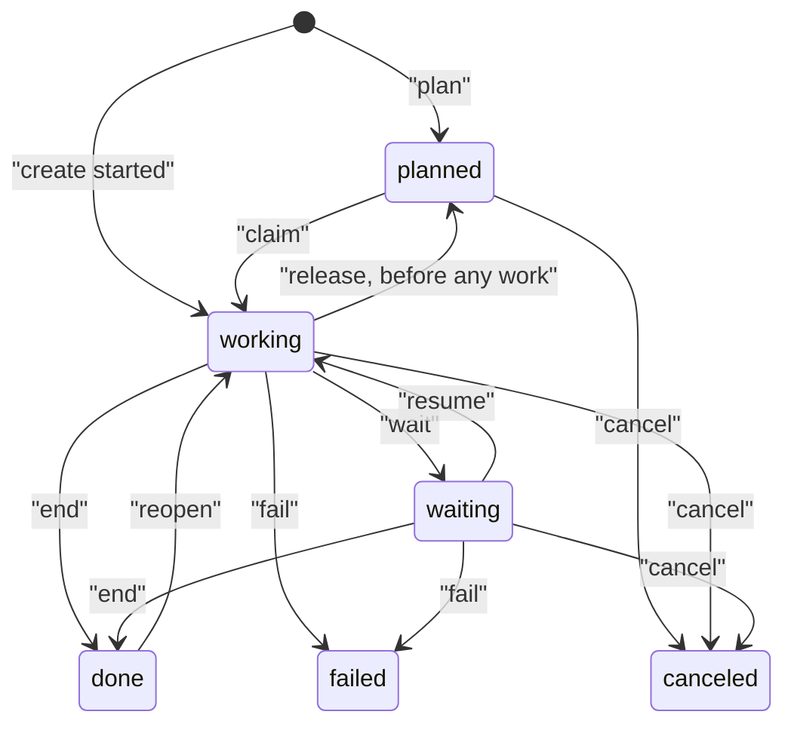

# Tasks

- **Status:** Proposed
- **Level:** Contract
- **Parent:** [Library](../product/library.md)
- **Related:** [Access control](access-control.md),
  [Storage](../architecture/storage.md),
  [Keys and references](keys-and-references.md), [Knowledge](knowledge.md)

> Agents do the work: they claim a task, write its checkpoints and files, and
> set its state. People and agents may plan a task; people may cancel one.
>
> A `working` or `waiting` task has exactly one holder, and only that holder
> writes into it.

## 1. Purpose

A task shows a reader what one piece of agent work did; its Scratchpad shows
how; its files hold the content it produced. Together they let a person
understand a session without reading the conversation.

## 2. Scope

This doc covers what the library stores and enforces for tasks, checkpoints and
files. When an agent creates a task, what its title and result say, and
when it writes checkpoints are in [Agent practices](agent-practices.md).

It does not cover:

- transcripts: full records of a session, with its reasoning, every tool call
  and its result;
- assigning a task to a named agent or person: any agent in the space may claim
  a planned task;
- leases and their expiry: a product that wants them keeps them and ends a hold
  with a release.

## 3. Tasks

- **A task records one piece of agent work.** Tasks and sessions usually match
  one to one, with two exceptions: one session may hold several tasks one after
  another, and one task may span several sessions. Subagents are not separate
  sessions.
- **A task is planned or started.** An agent creates a task started, as
  `working`, and becomes its holder. A person or an agent may instead create it
  `planned`, to be claimed later by any agent in the space.
- **A deleted task is gone.** A person may delete their own task, with its
  Scratchpad and files. Later writes to it are rejected as not found.

### 3.1 States

| State | Means | Holder |
| --- | --- | --- |
| `planned` | Planned, and nobody has started it | None |
| `working` | An agent holds it and works on it | One |
| `waiting` | Held, but the work waits on a person: an answer, or a request it submitted | One |
| `done` | Finished; the agent reports the work done. Not accepted or reviewed | None |
| `failed` | Finished without doing the work, with a reason | None |
| `canceled` | Deliberately not done, with a reason | None |

- **The library holds the state and refuses any other change**, with
  `task.state_invalid` naming the current state. The library never changes a
  state on its own, so a session closed abruptly leaves its task `working`.
- **Repeating the current state without a reason is a no-op.** The state, its
  reason, holder, end time, state attribution and waiting request link do not
  change.
- **`done` can be reopened; `failed` and `canceled` are final.** Reopening sets
  a `done` task back to `working`, for work that turns out missing; follow-up to
  a failed or canceled task is a new task that references it, such as `#TK-12`.
- **A reason comes with three states.** `failed` and `canceled` need a one-line
  reason. `waiting` needs one saying who or what the work waits on. A reason has
  1 to 2000 characters and no line break. The latest reason is shown with the
  state.
- **A request can hold its task in `waiting`.** When an agent submits a request
  from its task and asks to wait on it, the task becomes `waiting` with the
  request as its reason. Approving or rejecting that request, its withdrawal
  included, sets the task back to `working` if it still waits on it. See
  [Knowledge](knowledge.md#4-requests).
- **Who sets a state.** The holder sets `waiting`, `working` again, `done`,
  `failed` and `canceled`. A person may cancel their own tasks, and space owners
  and space admins anyone's, such as a removed person's task left `working`.
  People set no other state. Who may do each is in the [permission
  matrix](access-control.md#4-permissions).

### 3.2 The holder

- **A `working` or `waiting` task has exactly one holder**, an agent. Creating a
  started task makes its creator the holder; a claim makes the claiming agent
  the holder; ending the task clears it.
- **Only the holder writes into a held task**: checkpoints, file registrations,
  the title, the result and the state. Another agent is refused with
  `task.not_holder`, which names the holder.
- **Claiming a planned task.** Any agent in the space, except a space viewer's,
  may claim a `planned` task. The claim sets it `working`, makes the agent its
  holder, and moves the task to the agent's party: its person becomes the
  agent's sponsor. The task records who planned it. Of two agents claiming at
  once, one wins and the other is told the task is held, by whom.
- **Taking over a held task.** Another agent of the holder's party may claim a
  `working` or `waiting` task; the hold moves to it, and the state stays. This
  is how a person continues a task with another of their agents. An agent of
  another party is refused with `task.held`.
- **Releasing.** The holder may release a `working` task back to `planned` only
  while no work is recorded on it: no checkpoint, no file registration and no
  result write, even if deleted or cleared afterward. Otherwise it is refused
  with `task.has_work`, and the holder ends the task instead. A released task
  goes back to its planner's party. If it has no planner, release records its
  current person and the releasing agent as planner. Its agent name is cleared.
- **No expiry.** The library keeps no lease or timer. A hold ends only by a
  release, the end of the task, a takeover or a person's cancel. A product that
  wants leases keeps them and calls release.

### 3.3 Fields

A task holds:

| Field | Rule |
| --- | --- |
| Key | Such as `TK-12`, assigned on creation; see [Keys and references](keys-and-references.md) |
| Title | One sentence |
| State and reason (`state_reason`) | One of the six states; the reason for `failed`, `canceled` and `waiting` |
| State attribution (`state_changed_by`, `state_changed_agent_name`, `state_changed_at`) | The person who set the current state, the agent's copied name when an agent did, and the time; set on creation and each state change |
| Person | Whose task it is: the planner's person while `planned`, then the sponsor of the agent that claimed or created it |
| Agent | The holder, or for a finished task the last holder, by the name copied from the caller |
| Planner | Who planned the task, a person or an agent with its person; empty for a task created started until its first release |
| Created, start and end times | Start is set when the task first becomes `working`; end when it becomes `done`, `failed` or `canceled`, cleared when it is reopened |
| Last activity time | Set by the library whenever the task receives a checkpoint, a file or a new result |
| Result | Markdown text, rendered as Markdown |

- **State attribution describes the current state.** Claiming a planned task,
  releasing it, reopening it and waiting on a request record the caller. A
  request decision that resumes the task records the person who decided it,
  with no agent. A takeover or a title or result update keeps the attribution
  of the current state. Person names are resolved when read; agent names are
  copied when written.
- **The result is one field.** Each update replaces it whole; the Scratchpad
  holds the work history. An agent of the task's party may update a `done`
  task's title or result without reopening it.
- **Finding tasks.** A space's tasks can be filtered by person, agent and state,
  and searched by keyword in titles and results. Two more filters list the
  caller's party's tasks that are `working` or `waiting`, and the `planned`
  tasks the caller may claim. An agent is matched by the name copied onto its
  tasks, which is unique among one person's agents; see [Library
  architecture](../architecture/library.md#61-caller).

## 4. Scratchpad

The Scratchpad records how the agent did the work. It holds checkpoints only.

- **A checkpoint** is a short Markdown entry with a time, rendered as Markdown.
  Times strictly increase within a task, so a checkpoint's time names it. A
  task's Scratchpad is its checkpoints in time order.
- **Each checkpoint records its writing agent by name**, copied at the time
  of the write. A takeover does not change earlier checkpoints' attribution;
  the task identifies their person.
- **The Scratchpad is append-only.** A checkpoint cannot be edited. Only the
  holder appends one. A person may delete single checkpoints in their own tasks;
  agents cannot delete checkpoints.
- **One tool for every harness.** The library offers one MCP tool for writing
  checkpoints. The tool serves every harness.
- **Only a `working` or `waiting` task accepts checkpoints.** Other states
  return `task.state_invalid`, with a hint to claim or reopen first.

## 5. Files

Files hold immutable content, often large, such as reports, images,
exported documents or data.

- **Only the holder registers a file**, on a `working` or `waiting` task.
- **Each file records the registering agent by name**, copied at registration.
  Reporting it complete does not change that name; the task identifies its
  person.
- **Any agent of the task's party may report an upload complete**, including
  after a takeover or after work finishes.
- **Uploads take two steps.** The agent gets a short-lived upload URL and
  the headers to send with it, through MCP or a product's entry point, then
  transfers the content over HTTP. Downloads work the same way.
- **Each upload URL writes the content once.** The URL can be reused until it
  expires, but only one upload succeeds:
  - an upload without the returned headers is rejected with 403;
  - once a file is uploaded, another upload to the same URL is rejected with
    412, so a 412 means the content is already in storage;
  - a failed or interrupted upload leaves no content, so the client may retry
    with the same URL.
- **An upload is complete only when the client reports it.** Until then the
  file is not listed among the task's files, and no download URL is
  issued for it. A report before any content is in storage is refused with
  `agent_file.not_uploaded`.
- **An oversized file is refused when the upload is reported complete,
  and the refusal is final.** When the stored content is over the size
  limit the product sets, the report is refused with `agent_file.too_large`
  and the content is deleted. The file is never listed, and every later
  report of it is refused with `agent_file.refused`, even after a new upload
  to its URL; to upload a smaller file, the client registers a new
  file.
- **Each file has a file name and a one-sentence summary.**
- **Files are immutable.** To update one, upload a new one.
- **How browsers show files** is in
  [Storage](../architecture/storage.md#3-file-storage).
- **A file belongs to the agent's current task.** Opening a task shows
  its Scratchpad and files.
- **Deleting.** A person may delete their own files; agents cannot.
